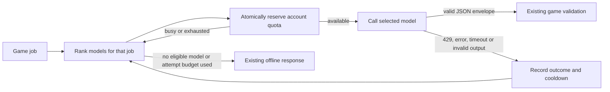

# AI provider pool for THE GAME

Built for private development, 12 October 2026. The pool automatically prefers the strongest **configured eligible** model for each game job, then tries lower-ranked choices when quota, concurrency, health or response quality prevents using it. A lower `rank` is preferred. These are editable starting preferences, not benchmark results or a guarantee that one model is more intelligent than another.

## Which models serve which jobs

| Game job                                  | First configured preference | Next preference   | Why this starting order                                                       |
| ----------------------------------------- | --------------------------- | ----------------- | ----------------------------------------------------------------------------- |
| `plan`: dawn schedules and projects       | Gemini 3.8 Flash            | Groq GPT-OSS 120B | Prefer the current verified free-tier Gemini model for coordinating residents |
| `reflect`: memories and identity          | Gemini 3.8 Flash            | Groq GPT-OSS 120B | Prefer synthesis and continuity over response speed                           |
| `talk`: resident-to-resident conversation | Groq GPT-OSS 120B           | Gemini 3.8 Flash  | Keep a large model while favouring interactive response time                  |
| `player`: reply to the player             | Groq GPT-OSS 120B           | Gemini 3.8 Flash  | Same dialogue preference, with a smaller output allowance                     |

Additional configured fallbacks are NVIDIA Nemotron 3 Super, Cohere Command A+, Mistral Small, OpenRouter's free router, and local Ollama/Qwen3. Cohere ranks ahead of NVIDIA for dialogue. All seven start disabled. Enable only providers with a key and a confirmed suitable free/evaluation account. OpenRouter's `openrouter/free` chooses its own model and cannot promise the most capable model; replace it with a currently available named `:free` model if you need a fixed choice. Local model quality and speed depend on your hardware.

To favour intelligence for every job regardless of speed, assign your preferred reasoning model and the lowest rank to **all four routes**. The router always checks ranks first; it does not round-robin away from a healthy first choice. Changing models and ranks does not reset usage. The same provider's models share its account quota and concurrency limit.

## Run locally

Use Node 24 and this checkout, `llm-pool`:

```sh
npm ci
npm run ai:pool -- init
cp config/mind-pool.env.example .env.local
```

1. Put your provider keys into `.env.local` on your machine. No key is needed for local Ollama.
2. Edit `config/mind-pool.local.json`. For chosen providers set `enabled: true` and `freeTierConfirmed: true` **after checking the account is using its free/evaluation tier**. These fields do not inspect billing or convert a paid account to a free one.
3. Check that each model is available in the account. Set provider `limits` from the account dashboard, conservatively. The included limits are local safety ceilings, not promised provider allowances. Account-wide quotas include your other applications; reduce the pool allocation accordingly.
4. Run:

```sh
npm run ai:pool -- status
npm run ai:pool -- demo
npm run ai:pool -- dev
```

`status` reports key presence without printing keys, plus the preference order for every job. `demo` shows a mocked 429 followed by a successful ranked fallback using a disposable SQL ledger; it makes no external model calls. `dev` loads `.env.local`, opts this process into pool mode and starts the normal game on port 8080. The existing auth/preview requirements still apply. `init` refuses to overwrite an existing config.

In the seven-resident integration checkout, `npm run ai:pool -- preview` starts the built game on `127.0.0.1:8081`. Build first with database/provider credentials unset. The build copies PGlite's matching runtime binaries beside its bundled server module, so local quota tracking can initialize in the production preview.

For a controlled comparison, set `MIND_POOL_CONFIG_FILE` to an ignored configuration containing one enabled provider and `maxAttempts: 1`. Run `LIVE_TOWN_URL=http://127.0.0.1:8081/ node scripts/live-seven.mjs --run` only when deliberately requesting a live test. It creates an isolated synthetic town, makes at most 13 paced player requests, requires every answer to be applied as live AI, checks money/debt/project invariants and reload, and writes local results under ignored `artifacts/live-seven/`. It does not read or replace a personal browser save. Model reasoning can use output tokens; an allowance that is too small may truncate JSON before its reply is complete.

Each route has `model`, `rank`, and `maxTokens`. For example:

```json
"plan": { "model": "gemini-3.8-flash", "rank": 10, "maxTokens": 6000 }
```

The output allowance includes any model reasoning that the provider counts against `max_tokens`. Longer reasoning can consume that allowance or hit the timeout before producing JSON. Increase it within your quota after comparing real game results, or use a faster model. Default per-attempt timeout is 12 seconds; the provider I/O deadline is 30 seconds with at most three attempts. Database queries have separate 3-second bounds when using Postgres. Gemini routes use medium reasoning effort for planning/reflection and low effort for dialogue to keep deliberate work within the interactive deadline. Other compatible routes can opt into `reasoningEffort` after checking model support.

## How requests work



The simulation still decides valid actions, money, debts and schedules. Pool JSON is checked for the expected envelope; the existing `parseMind` and effect validation remain the final gate. No town/save schema changes are needed. The legacy `mind: "grok"` save marker currently means an online response in the existing game contract; detailed provider/model attribution is kept in the server ledger.

Request quotas use rolling 60-second, 24-hour and 31-day windows. This is deliberately conservative around provider reset times and calendar months. Token reservations use UTF-8 input bytes plus an overhead allowance and the maximum output tokens. Failed requests and format retries count, and reservations are not refunded; actual reported usage is recorded separately and can tighten subsequent limits. This is a conservative estimate, not an exact tokenizer or a monetary billing cap.

The SQL account lock prevents concurrent workers from reserving the same remaining allowance. In-flight leases expire after a request timeout plus ten seconds, so a crashed worker does not hold concurrency forever. A provider may still be computing after a client abort; its own server-side limits remain authoritative.

A 429 honours `Retry-After` across the whole provider account. Authentication/payment errors disable the account until corrected; bad model configuration disables that model. Transient errors and malformed output cool down the model for 30 seconds. Unsupported JSON mode gets one explicitly identified format retry, charged as another attempt, then is remembered for that model. Redirects are rejected so keys cannot be forwarded to a redirected destination. A ledger failure returns offline/unreachable rather than making an unmetered call.

## Shared quota tracking and diagnostics

Recognizable Gemini, Groq, NVIDIA and OpenRouter credential prefixes are rejected for a foreign API host before quota reservation or transmission. `status` reports the match as a boolean, never the key. The consolidation retains this guard from PR #13 alongside the newer seven-resident prompt and gateway integration from PR #14.

Private local development can use the game's existing in-memory PGLite. That ledger resets when the server restarts and only coordinates that process. For persistent limits and multiple instances, use `DATABASE_URL` for an existing shared Postgres database and apply `migrations/20261012_mind_pool.sql` through the normal migration workflow. Pool mode refuses to run in Grok/Vercel deployment environments without a shared database. Other hosting environments must also supply shared Postgres; they cannot be automatically identified.

The new root migration means `npm run build` will migrate when a database URL is provided. Review the migration before deploying. Never validate against a production database unintentionally. Local validation uses:

```sh
env -u DATABASE_URL -u XAI_API_KEY npm run build
```

For a configured shared database:

```sh
npm run ai:pool -- usage
npm run ai:pool -- reset-health groq
```

`usage` shows the last 24 hours of attempts, successes, reported/reserved tokens, latency, and health. It performs no model calls or migrations. `reset-health` is for a corrected key/model or recovered provider; it preserves quota counters. Local PGLite lives inside the game process and is not available to a separate CLI process. Old attempt records are pruned after 32 days when that provider next reserves a request.

Prompts, replies, town saves and keys are never written to the pool ledger. Provider IDs, model names, job kinds, timestamps, status, token totals and latency are recorded. Model providers still receive the game prompt, including the relevant resident memory packet and the player's current text; their free-tier data policies apply.

On a host, use `MIND_PROVIDER_MODE=pool` and put the configuration JSON in the server environment variable `MIND_POOL_CONFIG`; local config files are intentionally ignored by Git. Secrets must be server environment variables named by `apiKeyEnv`, never `VITE_` variables. Deployment and production secrets were not changed by this implementation.

Unset the mode, or explicitly set `MIND_PROVIDER_MODE=legacy`, to use the existing Grok path. **Legacy mode can incur Grok charges.** Pool mode excludes Grok and rejects paid OpenRouter model IDs, but other providers' billing tiers must be controlled in their dashboards; a local `freeTierConfirmed` flag alone cannot guarantee a zero bill.

## Account/model checks and sources

Use the [community API list](https://github.com/mnfst/awesome-free-llm-apis) for discovery, then verify provider documentation and your account. No accounts, keys, paid credits or duplicate quota-bypassing accounts were created.

- [Groq models](https://console.groq.com/docs/models) and [rate limits](https://console.groq.com/docs/rate-limits): supported model IDs and account quotas. GPT-OSS 120B is the default large-model Groq choice.
- [Gemini OpenAI compatibility](https://ai.google.dev/gemini-api/docs/openai), [pricing](https://ai.google.dev/gemini-api/docs/pricing), and [limits](https://ai.google.dev/gemini-api/docs/rate-limits): compatibility endpoint, eligible free tiers, project quotas and free-tier data handling. 3.8 Flash is the current verified example. The earlier 2.5 models returned unavailable-for-new-users errors in live setup checks; verify model access before activation.
- [Cohere v2 Chat](https://docs.cohere.com/reference/chat) and [trial limits](https://docs.cohere.com/docs/rate-limits): separate adapter and a 1,000-call monthly trial cap. Its catalog allocation is 900 calls per rolling 31 days, and remains intended for this private development setup.
- [Mistral Chat API](https://docs.mistral.ai/api/endpoint/chat): compatible chat endpoint. Confirm free mode and exact account limits in Mistral's console before enabling it.
- [NVIDIA API reference](https://docs.api.nvidia.com/nim/reference/llm-apis): model API reference. Confirm Developer Program endpoint/model entitlement before enabling the example model.
- [OpenRouter limits](https://openrouter.ai/docs/api-reference/limits): free-model caps are account-wide; creating more keys does not increase them. The router uses only free model IDs for this provider.
- [Ollama compatibility](https://docs.ollama.com/api/openai-compatibility): optional local endpoint. Ollama must run on the same machine as the game server and have the selected model pulled. A cloud host's localhost is not your laptop.

The pool can raise the available capacity by aggregating legitimate allocations across providers, but cannot promise a particular increase before account quotas and real game-job latency/quality are measured. For a useful model comparison, score the same synthetic first-day jobs on JSON validity, character voice, memory grounding, valid schedules, and p50/p95 response time. Promote the winner by changing the corresponding route's rank/model. There is no automatic claim of model intelligence based on provider marketing or model size alone.
