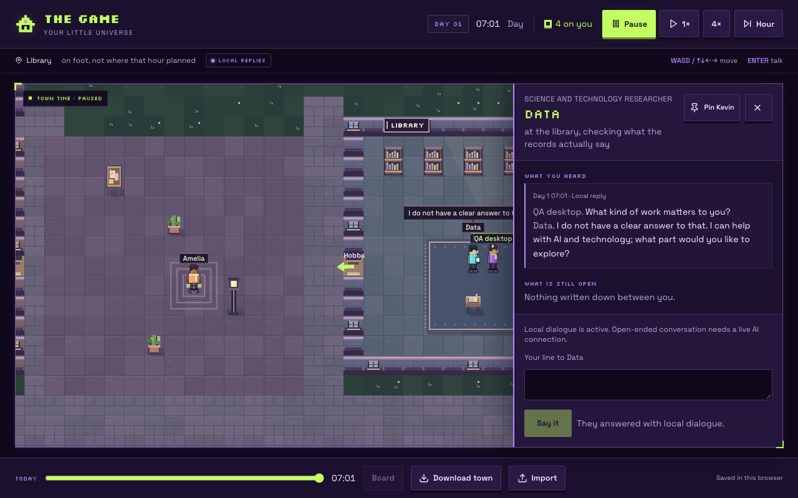
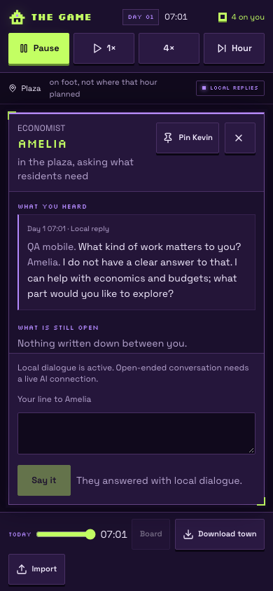

# Product consolidation — 12 October 2026

**Current integration, 19 October:** [PRs #30–#33](BRANCHES.md) are merged into main in order with merge commits after explicit user approval. Implementation integration checkpoint `426b00b` contains the verified `c84f69ed` tree: gameplay fixes, permanent identities, stamp appearance and private wallet tooling. Start new work from current `origin/main`; the checkpoint CI receipt is pending in the branch record. The old S1 draft is superseded and its recovery source retained, along with the merged source refs and checkouts. Hosted publication, human/accessibility checks, live provider/operator and wallet/funding acceptance remain pending; public funding stays disabled. This current status supersedes the historical branch/workspace inventory below, while the original consolidation receipt remains unchanged.

**Later implementation, 15 October:** this document preserves the consolidation snapshot. The quality candidate now integrates main through `4a39cdf` and activates the reconciled eight-actor ledger, funded library, durable work, inventory, save guards and provider budget. Its status and remaining gates are in the [delivery notes](implementation/game-quality-delivery.md) and [current roadmap](ROADMAP.md). The inactive-ledger and unbuilt-library statements below describe the earlier snapshot, not this candidate. Hosted publication remains separate.

The consolidation is merged into main through [PR #19](https://github.com/arwyn6969/the-game/pull/19), merge commit `8d15a722b61c09a7dca198ccf49ea8dd0b3f8125`. [PR #23](https://github.com/arwyn6969/the-game/pull/23) then added visible conversations and character cards at `8a35f3c877297b7a588aa8d38d6590e486f917cd`. Publishing that commit is still a separate action; a GitHub merge is not a live release.

The merge preserves the exact tested tree, `363f3de46f3c40e4981331de494e84354d8139e4`. [Main CI passed](https://github.com/arwyn6969/the-game/actions/runs/38296308695). The five incorporated PRs were automatically marked merged. [PR #16](https://github.com/arwyn6969/the-game/pull/16) remains the inactive funded-accounts draft. [PR #23](https://github.com/arwyn6969/the-game/pull/23) is merged and is part of current main.

## What the candidate contains

| Source                                                                                             | Pinned head                                | Decision                                                                 |
| -------------------------------------------------------------------------------------------------- | ------------------------------------------ | ------------------------------------------------------------------------ |
| Main: trust repairs, neon UI, town graphics and share cards                                        | `a45410376274ac0dd385029ef80e2ef1e56d2309` | Preserve as the integration base                                         |
| [PR #14](https://github.com/arwyn6969/the-game/pull/14): seven residents and coherent conversation | `578ab313d8679aab80a9badef058dbd36f51be30` | Integrated with current graphics                                         |
| [PR #13](https://github.com/arwyn6969/the-game/pull/13): provider pool                             | `19920725eda43dba1103c0290d4fecdd93afdc98` | Integrated; retain credential-host guards missing from #14               |
| [PR #6](https://github.com/arwyn6969/the-game/pull/6): Kevin memory interest                       | `12e8358d0d869f8a7c25387ee39cbc815d9bf284` | Integrated with pair-specific privacy and newer authored offline replies |
| [PR #5](https://github.com/arwyn6969/the-game/pull/5): roadmap and reviews                         | `a8e9098c4d0be76e96138fc0db7f34b662661d01` | Integrated; refresh current status and retain dated reviews as history   |
| [PR #9](https://github.com/arwyn6969/the-game/pull/9): contributor handoff                         | `bd24550f215260b740518d17e217a5bb0bee7ded` | Integrated; refresh baseline and gateway/pool accounting scope           |
| [PR #16](https://github.com/arwyn6969/the-game/pull/16): S1 funded accounts                        | `53bd9ac5b4354ac00195685cca429d7ca0681944` | Preserve separately; not activated or copied into this runtime           |

Merge commits retain the five source PR heads in the candidate's ancestry. Runtime integration preserves released depth ordering, directional walking, night lighting, pause/replay/reduced-motion behavior and the new residents' distinct palettes/accessories. The latest gateway, quota diagnostics and PGlite build repair remain alongside the provider credential guard.

Kevin's small technology preference ranks only the permitted memory stream. Joint dialogue still excludes private identities and third-party exchanges. New regressions check that integration boundary. Offline greetings retain the newer authored responses rather than reviving the old unrelated-memory quote behavior.

## Saves and the unfinished economy

Ordinary version-1 towns import into version 2 with original resident state/history retained and Data/Amelia added once. The original browser storage key remains intact; new saves use `the-game-town-v2`. Version-2 exports cannot be read by older builds. Download a backup before moving a personal town to the candidate.

S1 is deliberately unused on its source branch. It assumes six actors, version-1 saves and a fresh opening total of 77; this candidate has eight actors and a fresh total of 90. Its migration, new resident accounts and opening/arrival accounting need reconciliation before complete S2 activation with player-facing terms. The current legacy economy still has its earlier funding/payroll limits. The funded library project is not playable yet.

An experimental file with an `economy` extension is rejected before roster migration or balance normalization. Browser recovery retains every original byte; file import leaves the current town intact. Use the S1 source branch to inspect those experimental books. Do not silently strip the extension or manufacture balancing entries. The regression covers both v1 and v2 inputs and raw recovery.

## Validation

Node 24.19.0, a fresh locked install, and no copied environment files:

| Check                                   | Result                                                                                                                           |
| --------------------------------------- | -------------------------------------------------------------------------------------------------------------------------------- |
| `npm ci --offline --no-audit --no-fund` | Passed; 425 packages installed from cache                                                                                        |
| `npm run typecheck`                     | Passed                                                                                                                           |
| `npm run lint`                          | Zero errors; one inherited unused auth directive warning                                                                         |
| `npm run test:town`                     | 144 passed; zero failures/skips                                                                                                  |
| `npm test`                              | 370 script + 55 app/auth tests = 425 passed; zero failures/skips                                                                 |
| `npm run diagnose:town`                 | No world-audit issues; all six measured exports through day 30 imported                                                          |
| `npm run build`                         | Passed with database/Grok credentials unset; migration skipped                                                                   |
| Browser journey, 1280×800 and 390×844   | Name entry, keyboard/touch movement, time/pause, conversation, import/export and reload passed                                   |
| New resident browser interactions       | Data and Amelia replied offline; balances, debts and player agreements stayed unchanged; all three conversations survived reload |
| Renderer                                | Pause, replay, reduced motion, tree occlusion and town immutability passed                                                       |
| Built preview                           | Eight actors, v2 storage, offline startup and reload passed at both viewport sizes                                               |
| `git diff --check`                      | Passed                                                                                                                           |

[Browser results](review/consolidation/browser-summary.json) include layout checks and zero console/page errors for both development journeys. The local headless renderer timing is an observation on this machine, not a device benchmark. The wage diagnostic counts favor receipts rather than reflections quoting those receipts.





Production build smoke checks used isolated synthetic towns. Existing auth/PWA tests remain enabled; no safeguard or production setting was changed. Live provider calls, hosted publication, real-device keyboards, sustained provider capacity and a shared monetary budget cap were not reverified. The earlier provider handoff records historical live checks. All pool providers still default to disabled; legacy provider configuration remains the default.

Reproduce the browser journey against a warm local development server:

```sh
env -u DATABASE_URL -u XAI_API_KEY -u MIND_PROVIDER_MODE npm run dev -- --port 8090
GRAPHICS_QA_URL=http://127.0.0.1:8090/ GRAPHICS_QA_OUT=artifacts/consolidation/browser node docs/design/graphics-checks.mjs
```

The normal development contract remains port 8080. Port 8090 is this isolated review server. The built candidate is available locally on 8091; no existing process was stopped to claim either port.

## Branch cleanup

GitHub started with 19 branches including main, six open drafts, eleven merged PRs and two closed predecessor PRs. The [original branch manifest](review/consolidation/branches.json) pins every original remote head. The [completed cleanup receipt](review/consolidation/cleanup.json) records the merge, incorporated PRs and all 17 deleted refs. That cleanup left main, the economy foundation and the consolidation checkpoint. Later publish and button branches were merged and then removed; the current remote branches are listed below.

After the user's release approval, PR #19 was merged with a **merge commit**, preserving source ancestry. Every retired branch's head matched the manifest, was unprotected and was reachable from merged main. No open PR still needed those heads or bases. One atomic push deleted the 17 refs, with an expected-head lease for each deletion so an advanced branch would cause rejection. PR #16 was retargeted from `codex/playability-review` to main before retiring that base; its v2 reconciliation remains outstanding.

The following 17 remote branches were retired:

```text
codex/agent-collaboration-setup
codex/developer-handoff
codex/first-day-integration
codex/free-api-pool
codex/graphics-release-evidence
codex/grok-player-experience
codex/grok-trustworthy-talk
codex/kevin-technology-retrieval
codex/live-release-evidence
codex/male-residents
codex/neon-arcade-ui
codex/neon-share-cards
codex/playability-review
codex/seven-resident-coherence
codex/sol-foundation
codex/town-graphics
codex/trust-repair-followup
```

`main`, `codex/funded-project-accounts`, `codex/character-social-ui` and the consolidation checkpoint remain. After PR #24, the already-merged `codex/vercel-tanstack-preset`, `codex/vercel-output-config` and `codex/remove-pin-kevin` branches were deleted. A local Git bundle at `artifacts/consolidation/pre-cleanup.bundle` preserves the earlier refs in that checkout. This bundle does not include uncommitted work, ignored credentials or personal saves.

## Workspace cleanup and next work

Use the isolated `product/` checkout on main. Existing checkouts were not moved or deleted. In particular, `character-social-ui/` has a pre-existing unresolved merge, staged assets and ongoing uncommitted social/UI work; its linked `intelligence-ui/` repository must remain in place. The three coherence checkouts point to that repository too. The older review export is not a standalone Git checkout.

The next product step is one result that is still visible tomorrow. Do not merge PR #16 until its six-actor ledger is reconciled with eight actors and a fresh total of 90. Pin on current main keeps one resident at the front of the strip. It does not redirect messages. Retire or archive old local checkouts only after their owning work is finished and uncommitted/private files are preserved.

The user explicitly authorized the main merge and branch cleanup on 12 October 2026. Both are complete. Hosted publication remains a separate release action under [AGENTS.md](../AGENTS.md).
