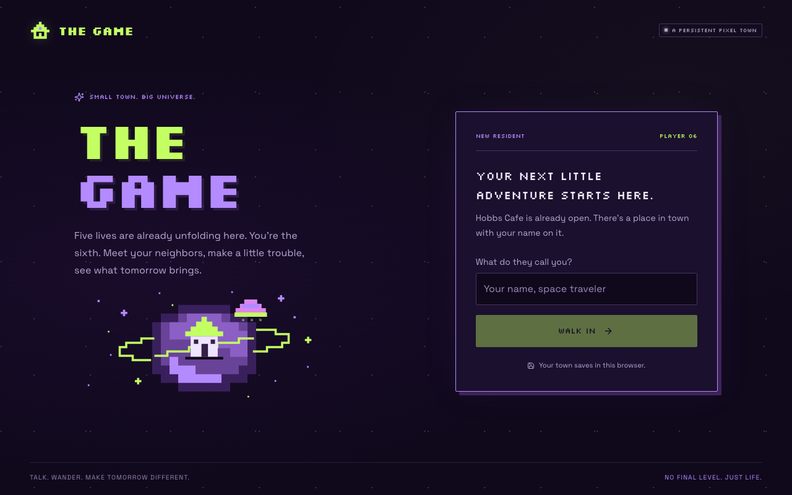
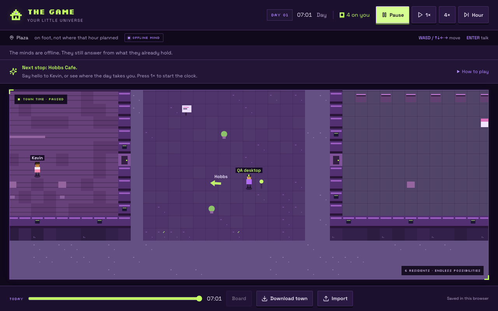
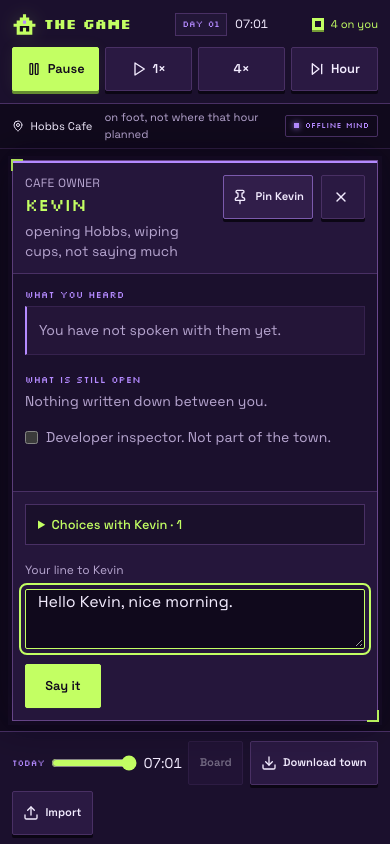

# Neon arcade UI

12 October 2026. Branch `codex/neon-arcade-ui`, based on released `main` at `900015b2a3bba0a0826ea6d814f72af2f47dc7f0`.

The game defaults to a dark purple and neon lime arcade theme, including native form controls when the operating system prefers light mode. The welcome screen introduces the sixth resident with pixel typography, a starfield and an original SVG house planet. The town uses violet terrain/buildings, green trees, lime lights and pink details; resident skin, hair and distinguishing outfits stay recognizable.

The interface separates the clock, wallet and time controls from place/activity information. A compact Hobbs welcome tip keeps the full movement and conversation instructions under **How to play**. Framed map corners, pixel status badges, purple conversation cards and lime active controls carry the same design through play, noticeboards, backup confirmation and recovery screens.

| Role             | Color     |
| ---------------- | --------- |
| Background       | `#10091c` |
| Panels           | `#1b102d` |
| Raised controls  | `#2a1942` |
| Primary / active | `#c3ff63` |
| Purple accent    | `#b48aff` |
| Pink accent      | `#ee8bdf` |
| Main text        | `#f3ecff` |
| Secondary text   | `#b6a5cf` |

Silkscreen is the display face; Space Grotesk keeps dialogue and controls readable. Both use the existing Google Fonts loading mechanism with system fallbacks. Decorative artwork and map overlays ignore pointer input. Reduced-motion preferences stop transitions and preserve the existing reduced-motion rendering behavior.

## Browser evidence

These screenshots use new synthetic towns in isolated Chromium contexts, never a personal save.

Browser checks at **1280 × 800** and **390 × 844** exercised name entry, keyboard movement, phone touch direction controls, 1×/pause, conversation entry with Enter, an offline reply, closing the panel, town download, import confirmation and reload persistence. Dark mode was checked with a forced light system preference. No horizontal overflow or browser console/page errors remained; composer and close controls fit both viewports.

An independent UI review also checked **320 × 568**, **390 × 667** and **844 × 390**. Expanded help keeps the map at 164, 257 and 195 pixels high respectively, with the footer in view. On short phones the conversation uses the viewport; in landscape expanded Choices scroll within the composer. Actual offline submission and Close worked in all three sizes, including submission with Choices expanded in landscape.

## Validation

Node 24.19.0, existing locked dependencies:

- `npm run typecheck`: passed.
- `npm run lint`: zero errors; one inherited unused-disable warning in `src/lib/auth/use-current-user.ts`.
- `npm run test:town`: 64 passed.
- `npm test`: 262 script tests plus 55 app/auth tests passed.
- `npm run diagnose:town`: completed; no world-audit issues and existing long-play exports still import.
- `npm run build`: passed with `DATABASE_URL` and `XAI_API_KEY` unset; database migrations skipped.
- `git diff --check`: passed.

The isolated browser first hit a cold Vite dependency-cache 504 while builds and tests warmed the cache. The warm-server checks passed with zero browser errors. Save schemas, simulation rules, model calls, authentication, PWA integration and camera/hit geometry were preserved. Hosted publication, real-provider dialogue and physical-device keyboard behavior were not part of these checks. This branch is a UI review candidate; it has not been merged or published.
