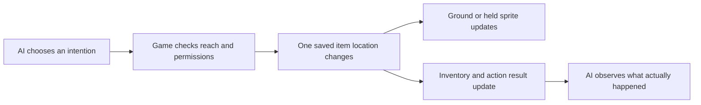

# Physical interaction foundation — one manuscript before a theatre system

Revision: 22 October 2026. This narrows the immediate task in [Northern's Park Players](northern-park-players.md). The community brief describes the programme; **CP0 is the bounded technical proof**, not a commitment to implement every programme packet at once. The source audit below records the pre-prototype implementation. The current feature branch implements the ground/held manuscript, real saved text, procedural carrying/reading art and optional eight-decision AI trial; see the [implementation receipt](../review/manuscript-prototype-2026-10-22.md) for local validation. A later authorized [real-model trial](../review/northern-real-ai-2026-10-22/README.md) demonstrated the tool loop but failed factual grounding. Hosted publication and broader event acceptance remain open.

The authorized [grounding correction and repeat](../review/northern-grounding-repeat-2026-10-22/README.md) now supplies actual personal facts and treats document contents as unverified claims while allowing fiction. Northern wrote grounded notes, reread them, carried the manuscript to the noticeboard and put it down; reading afterward was correctly rejected because he no longer held it. The next small improvement is state-aware legal-action guidance, with no silent relaxation of the physical rules.

**23 October current implementation:** Subsequent bounded work adds adjacent-ground reading, current action options, retained known revisions and continued decisions after speech. The [latest real trial](../review/northern-speech-continuation-2026-10-23/README.md), source `9574d5f`, chose pickup, reading, grounded budget writing, reading the new words and an expanded note. A sixth empty provider response stopped the run: 8,000 known tokens plus one unknown sample. It did not choose speech, fiction or a community event. The original proof outline below retains its earlier scope; the linked receipts define current implemented rules. Shared creative progress remains an acceptance gate.

## What was missing from the earlier plan

The creative direction is usable, but the earlier brief moved from intentions to a whole community event without specifying how game state becomes visible action. It also combined several independent efforts: AI runtime, creative collaboration, physical props, inventory and continuous server operation. They should not be one first implementation packet.

The missing foundation is the connection between a supported action, the object's saved location and what the renderer/inventory display. It does not require a new graphics engine or a complete crafting game.

## Source audit before the prototype

| Area | Existing capability | Missing connection |
| --- | --- | --- |
| Resident art | Procedural Canvas pixel drawings, per-resident palettes/accessories, four facing directions and animated arms/legs | A physical held item and carrying pose driven by actual item state |
| Movement | Tile pathfinding, collision, resident avoidance/yielding, visual interpolation and distance-driven stride | An item action must approach and recheck its target; an intention is not arrival |
| Book/bread/cup poses | Small stationary hand drawings selected from location/status text | They are not proof of custody, disappear while moving/back-facing and cannot represent a transferable object |
| Furniture | Cached procedural scenery derived from a static collision map | A table is not a movable object or an inventory container; do not expose unsupported pickup |
| Reading marker | A visible open-book destination marker | It is a meeting indicator, not a book someone can take |
| Inventory | Mainly the player-specific loaf, stored as an open project with exact identifying text | No general per-resident item registry, ground location or shared pickup/put-down action |
| Save/recovery | Validated v1/v2 towns and protected financial/identity history | Any new physical-item state needs an optional validated extension and backward-compatible loading |

Source: [renderer and hand poses](../../src/game/render.ts), [static world art](../../src/components/town/WorldArt.ts), [map and furniture](../../src/game/world.ts), [navigation](../../src/game/navigation.ts), [loaf actions](../../src/game/effects.ts) and [inventory panel](../../src/components/town/PlayerTools.tsx).

## Recommended first milestone: CP0

**One AI resident can handle one real manuscript, carry it to the park and use its actual text. The player can see where it is, and a reload preserves that state.** Another resident can use the same commands on the same manuscript; no resident-specific item implementation is needed.

The following is a capability demonstration, not a compulsory story:

1. A distinctive manuscript lies on a clear, legal library floor tile. Inspection reveals its title, source label and revision; reading its actual text requires pickup in this first proof.
2. Northern decides to approach and take it. After reaching it, a successful pickup removes the ground drawing and attaches that same manuscript to Northern.
3. Northern walks toward the park. The held manuscript remains visible in every facing direction, with existing walking motion.
4. Northern can read it or put it on a legal floor tile. Putting it down empties Northern's hand and displays the same manuscript there. Sub can independently approach and pick it up.

These steps can also be exercised with direct test commands to verify mechanics. That is not evidence of AI initiative. The real-AI demonstration uses model-selected intentions and speech; the engine validates the resulting actions. No authored conversation substitutes for an unavailable AI reply.

Start with ground placement. Putting books on tables requires supported surface slots, attachment heights and reach rules; add that only after the ground/held loop works. This avoids pretending every static table is already a container. The existing furnishings remain visually and mechanically consistent.

## Small state model

Keep one Town-level item collection as the source of truth. A manuscript needs:

- Stable item ID, kind and title.
- Reference to its actual saved text and revision.
- Owner/access policy, kept separate from whoever is carrying it. Start with one communal manuscript; borrowing it does not transfer ownership or authorship.
- Exactly one location: **on a legal ground tile** or **held by one resident**.
- A revision used to detect actions proposed against stale state.

Inventory is a view of this state: “which objects are held by this person?” Do not maintain a second mutable inventory array with copied item records. A held object derives its visual position from the holder; it does not pathfind independently or need coordinates updated every frame.

Initialize this one manuscript once, when deliberately entering the feature in a town with no physical-item extension. After initialization, a missing or invalid item is a state/recovery issue, not permission to respawn it. Do not create duplicate copies during reload or hide damaged data by replacing it.

For the proof, each resident has at most one carried physical prop. This is an explicit small capability limit, not a weight system or equipment grid. The new manuscript is nonconsumable. Leave the existing loaf/debt representation intact until a separate compatibility decision; do not create a second physical loaf or claim the old abstract loaf already follows this system. Display the legacy loaf and the new physical item honestly in the existing inventory panel.

## Commands and spatial rules

| Command | Required behaviour |
| --- | --- |
| Inspect | Return the actual item title, location and available actions. Inspection of a closed/held object does not automatically disclose private text. The proof manuscript is public. |
| Approach | Reuse the existing pathfinder to reach the item or an adjacent reachable tile. A blocked route reports waiting/failure; no teleportation. |
| Pick up | Recheck item ID/revision, public access, empty hand and legal same-tile/cardinal-adjacent reach at execution. Transfer location once. Two residents cannot both take it. |
| Put down | Require actual custody. Place on the actor's current legal floor tile, with no other physical item there; reject forbidden/door tiles. The paper is nonblocking. Do not silently move it to another tile. |
| Read | Resolve the actual content revision. Initially require holding the manuscript; provide that text to the AI and record only actual reading/speech actions. A status line cannot invent a book or establish that its contents were read. |

Start with pickup, put-down and read. Defer direct hand-to-hand giving: visible put-down/pickup already proves custody changes. Add giving later if people find that cumbersome, with adjacent willing recipient and capacity checks. Do not implement trading, theft, lending contracts, item weight or material crafting in CP0.

Action result, item location and resulting activity must agree. Reuse the existing validation/revision approach to prevent repeated transfers; a repeated or stale request returns a truthful current-state result without moving another copy. CP0 does not require a new general durable command ledger. Add only a bounded per-item receipt if a concrete integration demonstrates that need. A stale target, changed holder or invalid destination produces a reason and leaves the item unchanged.

## Exact visual work

The current renderer can be extended; no replacement sprite-sheet pipeline is required.

| Visual | Minimum art/renderer work |
| --- | --- |
| Ground manuscript | One small, distinct closed-manuscript drawing with a simple shadow and selection outline, drawn in the same depth system as the world |
| Carried manuscript | Shared hand attachment and four directional offsets, rendered while walking and standing; use the holder's interpolated position |
| Reading | Reuse/adapt the existing open-book drawing, now triggered by a valid reading action on a held manuscript rather than text matching |
| Pickup/put-down | A short shared reach/hold pose; no new bespoke animation set for each resident. State changes atomically, and animation reflects the committed transition |
| Inspection | Readable item name/highlight plus keyboard/touch action access; an action must not depend on accurately clicking tiny pixels |
| Inventory | A plain list or “Carrying: [title]” using the same state, visible for the player and inspectable residents |

Avoid a phantom copy: the manuscript must appear once, either in the world or with its holder. If a later version puts it on a table, do not leave a baked decorative drawing of the same manuscript behind. Decorative books elsewhere can remain scenery but must not advertise unsupported actions.

The real held-item drawing takes precedence over decorative status-based cup/book/bread poses. Do not stack a fake held book or cup onto the same occupied hand. Likewise, the existing reading-destination icon is a location indicator, not another copy of the manuscript; distinguish its presentation from pickable items.

Preserve palette, existing silhouettes and optional player Stamp heads. A carried prop cannot disappear merely because the resident turns north or starts walking. Respect pause and reduced motion. Historical position replay must not display current item locations as historical facts: initially omit physical-item overlays from replay with an explanation, or separately implement item history before claiming replay support.

## Practical packets and stopping point

### Code trace completed before implementation

The [source comparison receipt](../review/physical-source-audit-2026-10-22.json) records working-tree SHA-256 hashes for 27 relevant files. `product` was at `7ddda79`; the hosting owner's checkout was at `dab257b` with additional uncommitted hosting changes. Twenty-four compared files were identical, including all gameplay, movement, art, UI, save and identity files. Three AI server/transport files contain hosting-specific changes: manual redirect handling and request-local PostgreSQL adapters. Preserve those changes when integrating; do not copy this older checkout wholesale over the hosting work.

This is static inspection, not a live or automated runtime result.

| Existing code and entry point | Reuse and exact integration work |
| --- | --- |
| `src/game/types.ts` — `Town`, `ThinkJob`, `MindResult` | Add optional validated physical-item state without changing Town version 2 or existing exported function signatures. The four current AI job/result types contain no physical command. The autonomous bridge needs an explicit new action-decision type. |
| `src/game/prompt.ts` — `buildPrompt`, `parseMind` | Add an actor-bound action observation and strict command parser. Today an extra `nextAction` field is discarded because `parseMind` reconstructs only known fields. The existing talk prompt also says “No ending, no party”; audit that instruction against the desired open-ended social activity rather than assuming existing prompts already allow it. |
| `src/lib/mind.functions.ts` — authenticated `thinkTown` | Reuse the RPC, authentication, shared accounting and provider routing. This service obtains model output; it does not own canonical Town state or perform world actions. The local executor must still validate current state. |
| `src/lib/mind.gateway.ts`, `mind-pool/{types,config,transport,server}.ts`, `mind-budget/policy.ts` | Register the action job and response envelope. Keep the new provider route optional so the four existing routes/configurations stay valid. Current config validation and `poolAvailable` require every listed kind; blindly adding a required fifth kind would disable old configurations. Add capability-specific availability. |
| `migrations/20261013_mind_budget.sql` | Its table constraint and reservation function accept only plan/reflect/talk/player. A genuinely new `act` kind needs a new forward migration, not edits to this old migration. Action requests retain background accounting and require an explicit qualified allocation. No production migration is part of this planning pass. |
| New `src/game/physical-items.ts` | One optional versioned state, pure validator/selectors, explicit once-only initialization and typed pickup/put-down/read execution for all residents. Proposed helpers: `heldItem`, `validatePhysicalItems`, `applyPhysicalCommand`. Keep one custody record. Do not use a project description or memory as the authoritative location. |
| `src/game/effects.ts` — `applyResult`, `applyPlayerAction`, `adoptActionDraft` | `applyResult` returns void and tolerates partial edits, so it cannot certify an item command succeeded. Reuse/extract the existing staged action/adoption pattern for a typed success/failure result; preserve the live Town and existing resident object identities. Keep physical custody independent of financial balances and legacy loaf projects. |
| `src/game/sim.ts` — `stepMinute`; `navigation.ts` — `moveResidents` | Keep the existing pathfinder and one movement pass. Add a small physical-intent controller and merge its approach/destination goals with existing Library appointments under explicit deferral/priority. Do not overwrite a paid commitment or move the NPC twice. Arrival causes item preconditions to be checked again. |
| `src/components/town/TownApp.tsx` — `runMindRef`, `takeJob`, animation loop | Add bounded autonomous action dispatch, typed application and pending/unavailable state. Request another decision on actual completion/failure, not each frame. Preserve request generation, town/import/replay cancellation. Fix action relevance using actor/intent/item revisions; do not infer relevance from an unchanged global clock. |
| `src/game/render.ts` — `syncGlide`, `paint`, `drawPerson`, `activityFor` | `paint` already receives the live Town. Derive ground/held art from its item state, reuse interpolated holder positions and existing depth sorting, and add directional carrying/open-reading overlays. Current status-derived stationary poses cannot establish custody. Do not change optional Stamp heads or resident identity accessories. |
| `src/components/town/WorldArt.ts` — `scenery`, `propArt`, `floorArt` | Reuse fixed scenery. The CP0 ground item is a dynamic layer and never goes into cached floor art or the module-load scenery array. Surface slots are deferred; if later added, a designated table needs correct empty-top art/cache variants to prevent a painted duplicate. |
| `src/components/town/TownApp.tsx` — `onCanvasClick`, `chooseAction`, `persistTown` | Existing canvas picking selects residents and the board, not items. Add inspect/highlight bounds using the same camera transform, plus a keyboard/touch-accessible nearby-item action. Do not replace Enter-to-talk silently. Commit → persist → refresh React state for both player and NPC item actions. |
| `PlayerTools.tsx` — `carried`, inventory rendering; `CharacterSocial.tsx` — overview | The current inventory filters exact `BABA_LOAF` project text. Add a selector-backed physical-item entry and correct the empty-state message; preserve loaf/debt semantics. Show a resident's carried item from structured state under existing visibility rules. No separate mutable inventory array or grid. |
| `src/game/save.ts` — `validateTown`, `serialize`, `writeTown`, `exportTown`, `townFileProblem` | Unknown root fields currently serialize without validation. Add a pure physical-state check before mutating legacy repairs, after roster migration where needed, before write/export, and in recovery diagnostics. Paths are cleared during serialization; a saved approach intent must rebuild a path after load. Preserve raw malformed bytes instead of reseeding. |
| `src/game/identity.ts` — `forkTown`, `characterRef`, `townRecordRef` | Fork clones Town and changes only the identity registry. Store local AgentId/item references inside custody and derive external world/person references when needed. Embedding old absolute character/world IDs would leave stale references after a fork. |
| `TownApp.tsx` — import/replay/reset paths; `sim.ts` — `ScrubFrame` | Reset transient item selection on import and cancel old AI decisions. Historical replay records resident positions, not item locations; hide live physical-item overlays in replay until actual item history exists. |

### Autonomous AI bridge: explicit decision

For the intended watch-first experience, use a small **`act` job** through the existing AI gateway. Merely appending a field to dialogue is insufficient: it could support a player-triggered command, but would not supply the next autonomous decision. Daily planning runs when plan dates become stale, and incidental pair conversations have a 20-game-hour repeat gap. Do not manufacture player speech, fake a partner conversation or repeatedly pretend it is dawn to drive object handling.

The new job binds one NPC and permits one whitelisted intention: inspect/approach, go to a permitted destination, pick up, put down, read, speak or wait. Item verbs stay the same three; moving to the park explicitly reuses navigation. The model cannot choose another actor or control the player. Only perceived metadata/current custody and the previous actual tool result enter the decision; read supplies the manuscript's actual text/revision. A later AI decision may speak those words or respond to them.

After an intention, the engine owns bounded execution. A distant pickup persists its approach target, uses ordinary movement, and rechecks reach/custody/revision on arrival. It produces an actual result before another model decision is requested. A read result supplies content; it does not itself invent AI speech. Status/error messages are engine feedback, not fabricated quotes attributed to a resident.

Use one bounded active controller/session initially, reusing the existing call concurrency control. No separate agent framework, provider service, general job platform or per-frame inference is needed. Adding this job still requires the explicit cross-stack registration and budget compatibility work above. The current hosted policy disables background inference; do not relabel autonomous work as `player` to evade that setting.

### Background-response relevance must be addressed

`TownApp.runMindRef` currently checks that day, minute, `nextId` and (for background jobs) the player's position have not changed. The main loop only freezes the clock for player replies. Static consequence: a background response crossing an ordinary game-minute tick fails `fresh()` and is discarded. In addition, `takeJob` can apply an offline result for a newly emitted job while another request is pending, which can change `nextId` again. This was traced in code, not reproduced in a running app during this audit.

For the new action job, use the same Town/request generation plus current actor intent, item location/revision and content revision, then revalidate current command preconditions. Player walking elsewhere or an unrelated clock tick is not by itself proof that a pickup decision is invalid. Changing an imported town, losing custody or replacing the intent is. Keep existing old-job checks until their own semantics are reviewed; do not globally delete stale-result protection as an incidental item change.

| Packet | Deliverable | Difficulty |
| --- | --- | --- |
| CP0.1 State/command contract | Agree ground/held union, shared access, content reference, one-hand limit and pickup/put-down/read results. Freeze the small interface before parallel work. | 2/10 design |
| CP0.2 Mechanics/save | Optional item state, action validation, approach integration, atomic custody changes and validated save/reload. No event scheduler or construction system. | 4/10 |
| CP0.3 Art/UI | Ground/held/read manuscript drawings, directional carrying while walking, simple inspection and carried-item list. Parallel with CP0.2 after its interface is agreed. | 3–4/10 |
| CP0.4 Autonomous AI connection | Add the explicit optional `act` job through the existing gateway, envelope/parser, route capability and budget kind support. Add a bounded controller, action-specific relevance and real command feedback. Inference failure remains pending. Keep new database migration/configuration delivery separate from the mechanical proof. | 6/10; requires qualification and an allowed background allocation |
| CP0.5 Integrated review | Demonstrate the same manuscript through pickup, carrying, reading, put-down, another resident's pickup and reload. Review what is readable and worthwhile before adding objects. | 3/10 |

**Mechanical/visual manuscript proof: approximately 4–5/10. Autonomous AI bridge: approximately 6/10 as a separate packet.** The earlier single CP0 estimate understated this integration: the existing four-job gateway has no object-action result or ongoing controller. The broader 7–8/10 community programme, sustained all-AI service and 24-hour server operation remain separately measured work.

The immediate implementation boundary is CP0, plus a small AI-runtime feasibility review in parallel. A whole performance, all proposed community interfaces, every furniture type and release-wide runtime migration are not prerequisites for this mechanical proof. CP0 itself is not a public claim that the whole game already meets the all-AI promise.

## Evidence that matters

- Pickup/carry/put-down is visually readable without a narration claiming it occurred.
- The manuscript exists in exactly one place after two residents target it, after a repeated command and after reload.
- Its contents and custody survive saving; ownership, authorship and holding are not conflated.
- A changed target, wall/blocked route, full hand or invalid placement leaves state unchanged with an understandable reason.
- Turning, walking, stopping, pause and reduced-motion modes preserve a truthful display.
- Existing towns, loaf/debt handling, identities and finances remain valid.
- Direct command tests establish mechanics; a separate real-AI observation establishes that an agent can choose and use the capability.

## What follows only if useful

First use the manuscript capability in a small AI-led reading with actual responses and memories. The residents may develop it into a performance. Show them moving to places, facing a speaker and speaking actual AI-generated words; do not promise sophisticated acting animations before those are implemented.

Then consider one useful surface slot or second item. A reusable cue-board could use the same object identity/location/inspection patterns, but Baba making one still requires a separately specified work/source action. Movable tables and a general stage-building system remain later features.

There is no new inventory or construction implementation to undo from this planning branch. The correction is to reduce the first packet and make its visual/mechanical success concrete before extending the programme.
