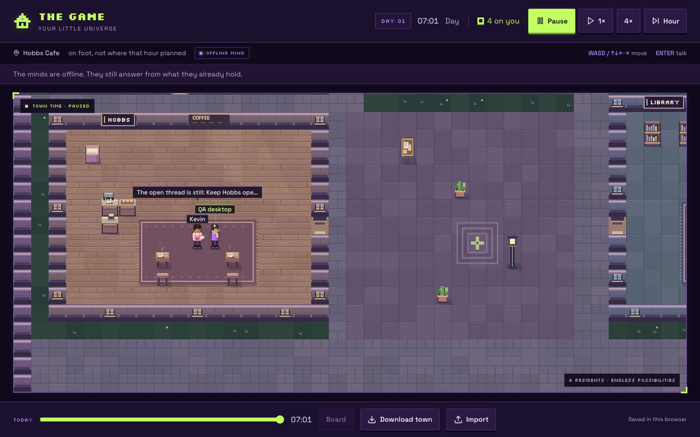
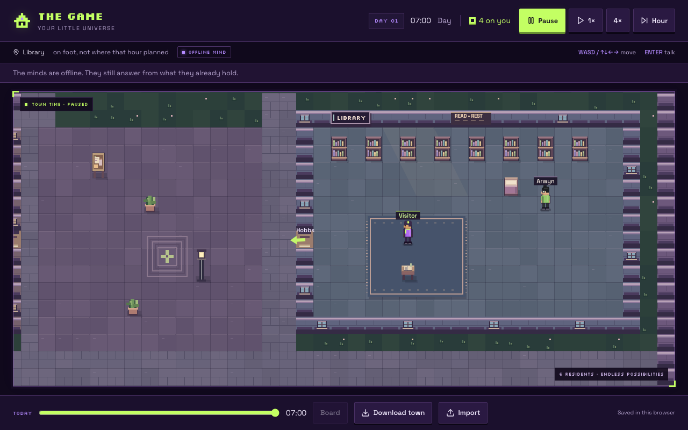
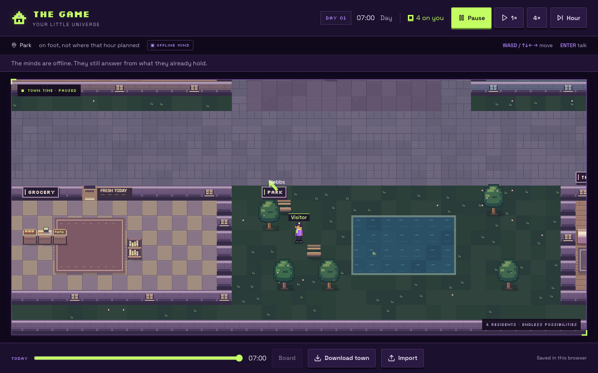
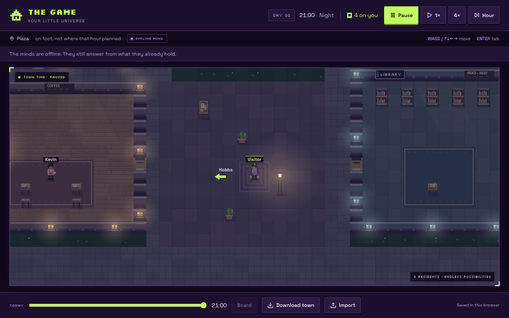
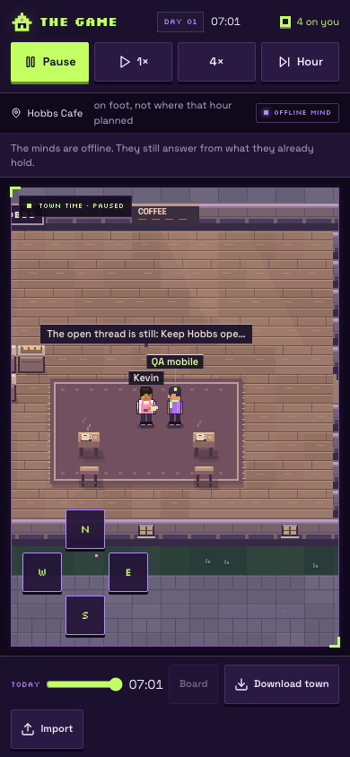
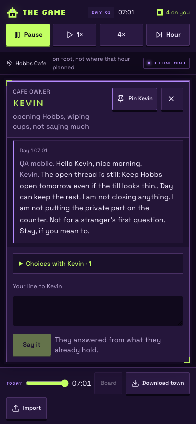

# Town graphics

12 October 2026. Graphics branch: `codex/town-graphics`, based on released `main` at `65d93a9`. This is a graphics review candidate; publishing is a separate release step.

The purple/lime arcade interface now surrounds a town with warmer, more distinct materials. Hobbs has oak planks, a woven rug, an espresso machine, brass fittings, pastries and steaming cups. The library has slate floors, individual book spines, an open reading book and window light. The grocery has bread, produce, jars and a checkout. Dorms and homes have framed beds, folded bedding and rugs. The park has stepped tree canopies, slatted benches, shoreline details and lily pads.

## Movement and depth

Residents keep their existing skin, hair and outfit colors, with stronger outlines, clothing highlights, apron ties, glasses, bags and a player scarf. North, south and profile views differ. Feet and arms alternate with actual movement distance; stationary residents do not walk in place. Small cup, book and bread poses use the public activity line already shown in the resident card.

Furniture and residents share a draw order based on their feet. A person north of a tree is behind its canopy; a person south of it appears in front. Furniture has ground shadows and highlighted tops. Raised art follows existing furniture cells; floor rugs and markings add no obstacles. Camera, picking, map geometry and exported game signatures stay compatible.

Adjacent name labels stagger rather than merging. Speech boxes reserve the name-label space and stay within the camera horizontally.

## Atmosphere

Dawn and dusk use restrained color washes. Night has darker blue surroundings, warm café/windows/lamps and cooler library windows, with light pools added after the world shade. Steam, water ripples, occasional falling leaves and park fireflies give the scene life. The clock's Pause also freezes ambient animation. Replay freezes animation and uses no current activity pose or live speech bubble. Reduced-motion preferences suppress ambient particles and resident animation.

Ground art, furniture sprites and light gradients are cached. Dynamic drawing culls objects outside the camera. No external image requests or new art dependencies are added. Rendering does not alter the town save.

## Browser evidence

All scenes and backups are newly-created synthetic towns in isolated Chromium contexts.













The desktop **1280 × 800** and phone **390 × 844** checks exercise name entry, keyboard movement, phone touch movement, 1×/Pause, Enter to talk, an offline reply, closing the panel, town download/import and reload persistence. Neither viewport has horizontal overflow; conversation controls remain in the viewport. Both checks finish with zero console or page errors.

The renderer checks compare actual canvas pixels: Pause freezes artwork; ambient effects animate while running; replay and reduced motion stay still; a tree occludes a person behind it but allows the person in front; repeated paints leave the save unchanged. Fonts finish loading before stability comparisons. Timings measure canvas drawing submission in headless Chromium, not physical-device frame rate.

To reproduce with Node 24 and the locked dependencies:

```sh
npm ci --no-audit --no-fund
env -u DATABASE_URL -u XAI_API_KEY npm run dev -- --port 8083
# In a second terminal, with the warm preview running:
node docs/design/graphics-checks.mjs
```

`GRAPHICS_QA_URL` accepts only a localhost HTTP root URL; `GRAPHICS_QA_OUT` sets the output directory. The default output is `/private/tmp/game-graphics-qa`. Generated backup files belong to these synthetic towns and are not committed.

## Validation

- Node 24.19.0, clean installation from the existing lockfile.
- Typecheck passed.
- Lint: zero errors; one inherited unused-disable warning in `src/lib/auth/use-current-user.ts`.
- Town regressions: 65 passed.
- Full tests: 263 script tests and 55 app/auth tests passed.
- Town diagnostics completed; no world-audit issues and long-play backups remain importable.
- Production build passed with `DATABASE_URL` and `XAI_API_KEY` unset; migrations skipped.
- Portable browser and renderer checks passed.
- `git diff --check` passed.

The first browser attempts hit Vite's outdated dependency-cache 504 while the initial cache and test loaders were running. A separate dependency installation and warm preview passed. Hosted deployment, physical-device keyboards and real-provider conversation were not exercised by this graphics pass.
