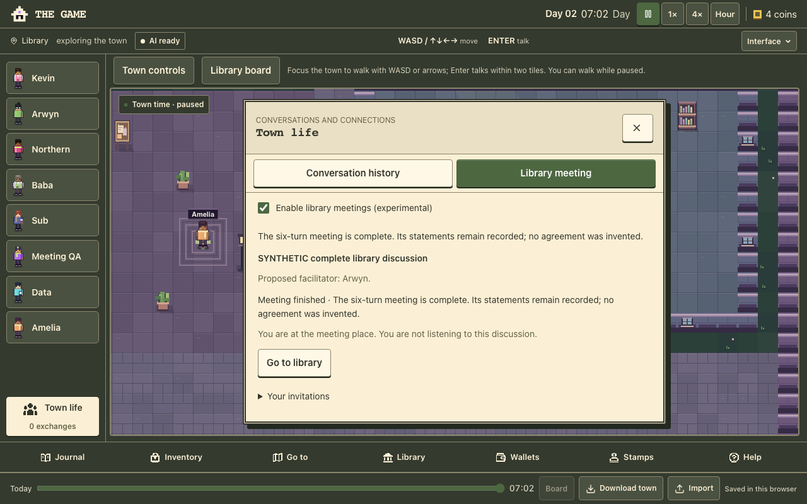
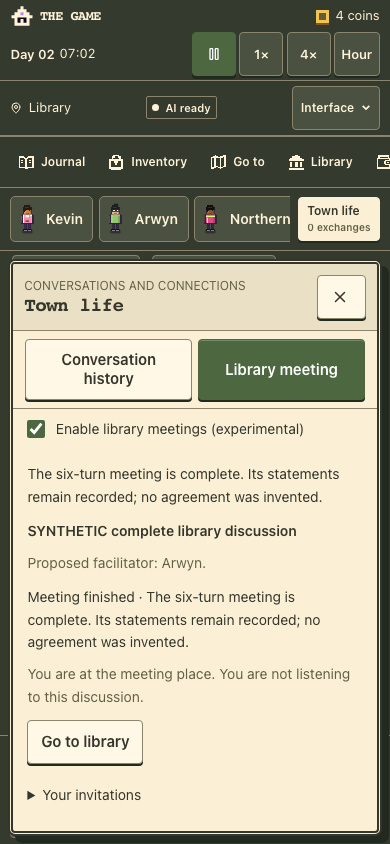

# A01.3 integrated local activity evidence

1 November 2026. Code `38d7442f31efed89ba6af25637a52f4537b3aa75` on
`codex/a01-qualify`, checkout `a01-replay/`. This explicitly combines reviewed
#61 `cd44d16`, #62 `44745f4`, and A01.2 `e115b57` (runtime `ab7d893`), retaining
their original ancestry and branches. Main remains `a26714e`. Only status
preambles conflicted; both histories were preserved. No economic, provider,
auth, save-schema or hosting change was introduced by qualification.

[Checks](checks.json) · [Source and artifact hashes](manifest.json) ·
[Reused SQL failure matrix](replay.json) · [Hosted trial packet](hosted-trial.md).

## Complete activity

The fresh normal-controls journey starts from a synthetic proposal and one
Start. Three residents choose currently offered read/accept/participate/speak
actions. Fifteen synthetic requests produce six actual spoken turns by Arwyn,
Northern and Sub, followed by natural six-turn closure. No earlier decision
history is imported into this journey.

The controller gets an unpaused dispatch window and real animation frames to
stop naturally; both the panel and global running controls disappear and there
is no additional meeting request. All eight knowledge projections and materialized
speech memories match actual audiences. Balances, debts, identities and previous
transactions remain intact. The player and uninvolved residents learn no speech
merely by viewing it. Reload is followed by ordinary Pause and a Web Locks save
barrier before the same audience/memory audit is repeated on the actually loaded
and saved town. The transcript and factual terminal receipt remain exact.

Normal ambient scheduling can resume after automatic mode stops. The mocked
transport records that separately; it is not another meeting request or a claim
that provider background work was authorized. The canonical server budget still
has zero background concurrency.

## Combined validation

- Node 24.22.1: 1,124 script tests, 55 typed tests and 441 separately run,
  overlapping town tests pass. The isolated authority/adapter suite passes
  42 cases. Typecheck, lint, diagnostics, credential-free Node and Cloudflare
  builds pass. One inherited lint warning remains; no production migration runs.
- The integrated 42-journey meeting run passes. Independent review then
  strengthened the new complete-activity assertions; the final focused desktop
  and phone rerun also passes, including natural global stop and actual saved
  reload knowledge. The unchanged terminal/race matrix remains covered. Final
  exact-head CI must run the standard full entry point with these assertions.
- The sixteen SQL failure cases pass on the integrated runtime with retained
  prior rows/charges, balances, identities, audiences and replay equality.
- Built desktop/phone journeys pass movement, conversation, pause, export/import,
  recovery, project/paid-receipt feedback, controls and work-choice review.
  Mocked AI recovery also passes. Four-interface checks pass 27 desktop and
  29 phone cases, including narrow layouts and enlarged text.
- Accessibility passes 54 audited surfaces and 27 essential checks, with zero
  violations and 19 incomplete rule results retained for human review. This
  does not establish physical-phone usability or WCAG conformance.
- The new action-only preflight passes eight focused tests within the full
  suite. Missing/stale/unauthorized evidence, exhausted independent limits,
  unsafe prices, unsettled leases and malformed inputs fail closed. The default
  CLI [actually reports not-ready](preflight-not-ready.json), performs no
  service queries and grants no permission or reservation.

All towns/transport in these local checks are synthetic and disposable. No live
inference, spending, production migration or personal-town change occurred.
Synthetic legal participation is a test input; these results do not establish
live model choices, conversation quality or enjoyment.

## Source and hosted gates

The intended draft is stacked on #62's branch, with merge order #61 → #62 →
A01 qualification. Qualify the final draft head's Verify result before any
integration. This record contains local results; use the corresponding PR for
current CI, and preserve the original heads if main advances.

The current public baseline could not be freshly hashed: the read-only asset
attempt returned HTTP 403. [Recorded limitation](public-baseline.json). The last
successful receipt remains 29 October/runtime `01470e291065`. Today's real
caller/provider allowance has not been attested; the preflight is not ready.
October's ledger and account counters are historical.

Publication and a real meeting need the exact source authorization and fresh
zero-spend headroom described in [hosted-trial.md](hosted-trial.md). Grok stays
paused; mobile, human enjoyment, physical-device, wallet and shared-server
acceptance remain separate. Astra's A02 economy design is independent.
