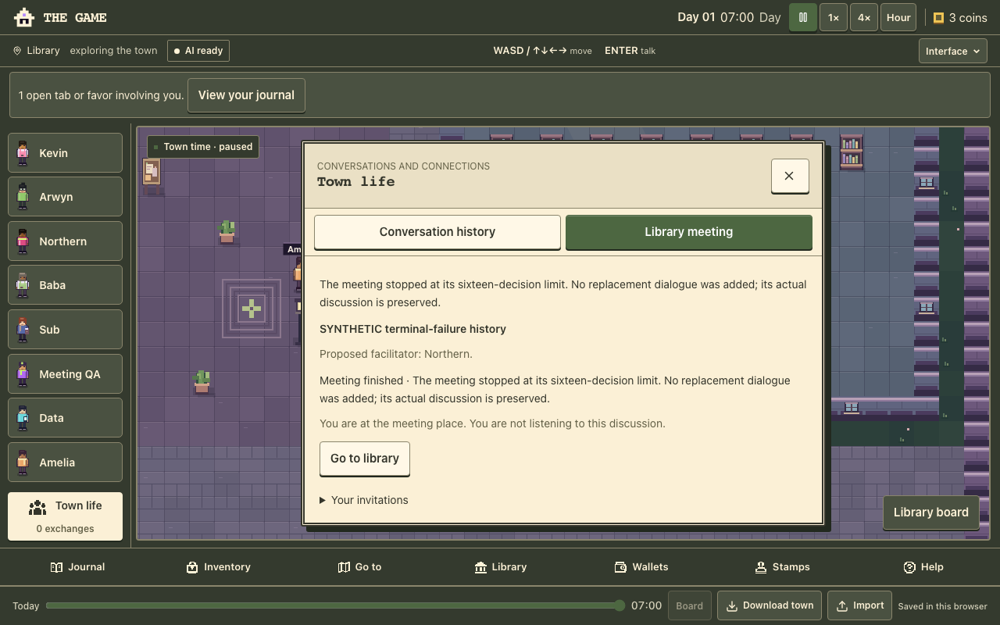
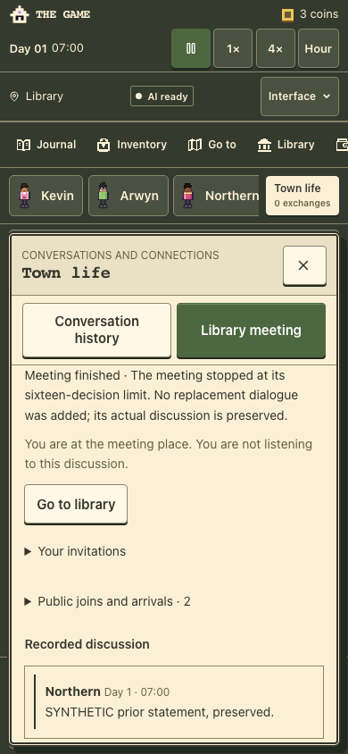

# A01.2 terminal failure verification

1 November 2026. Locally verified at code revision
`ab7d893c5fc2deeee046f6320c745f11e38bedc9`, checkout `a01-replay/`, branch
`codex/a01-terminal`. The local dependency is A01.1 handoff
`967d2bba8843b563de16c831cba98f1277449aa1`, based on main `a26714e`.

A failed or interrupted sixteenth decision now closes with a factual saved
receipt. No futile Resume or replacement dialogue is offered. A valid final
decision, including spoken words, commits before normal closure. Failures below
the cap still pause and require an explicit resume. Reload safely recovers old
exhausted pauses and unknown final requests while preserving uncertain usage.

[Baseline](baseline.json) records resumed ownership, dependencies and inherited
deployment evidence. [Checks](checks.json), [synthetic SQL replay](replay.json)
and [source/artifact hashes](manifest.json) identify the verified inputs.

## Evidence

- Node 24.22.1: 1,105 script tests and 55 typed tests pass. The separately run
  town suite passes 432 tests; these overlap the full script suite.
- Typecheck, lint, diagnostics and credential-free build pass. Lint retains one
  inherited unused-disable warning. Build confirms DATABASE_URL is absent and
  production migrations are skipped.
- Sixteen real-engine/parser/router/save/scheduler cases use a fake transport
  and disposable SQL stores. Previous rows, IDs, timestamps and charges remain
  exact; all eight identity/knowledge projections, finances and prior history
  survive. Conservative denied-request charges and unknown cancellation usage
  remain explicitly represented rather than refunded or fabricated.
- Forty intercepted React browser journeys pass at 1280×800 and 390×844:
  existing manual/automatic lifecycle and race checks plus fifteen terminal or
  recoverable cases per viewport. These include empty/malformed/unavailable
  results, provider failure, quota denial, client timeout, cancellation/late
  completion, pending reload, legacy exhausted saves, valid final decisions,
  final legal speech, cancelled legal speech, draft retention and below-cap
  explicit recovery. No page errors or unexpected server-function calls occur.
- A final legal spoken turn reaches exactly Arwyn and Sub, with one memory for
  each actual listener and its speaker Northern. The other five actors do not
  learn it. Duplicate response/usage delivery has no extra effect. A late legal
  spoken response after cancellation adds no words or memories.
- A new invalid proposal displays its own error after terminal closure; a
  subsequent valid proposal retains the old receipt and unsent draft and starts
  no AI request by itself.
- The meeting suite runs 44 accessibility audits with zero violations and six
  incomplete rule results retained for manual review. This is automated
  evidence, not physical-device or assistive-technology acceptance.
- The built desktop/phone journeys pass ordinary conversation, keyboard/touch
  movement, pause, reload, export/import, competing-tab handling, version-1
  migration, identity restore/fork and library/readings. Terminal screenshots
  were visually inspected on both viewports.

## Verification corrections and limits

The interrupted browser harness initially lacked funded-account initialization
for its prior synthetic payment. It now initializes accounts through the real
migration helper. Its retained baseline is normalized before comparison so the
save loader's explicit false memory defaults are distinguished from lost data.

Terminal comparisons pause ordinary time to isolate failure handling from normal
payroll and ambient activity. The pending-reload case changes only the synthetic
save's paused clock flag, retaining the actual pending request. The browser first
observes live recovery and then uses ordinary Pause to save it: loading preserves
the original raw save until a normal save action. Existing automatic/full-play
journeys still exercise moving time separately. These fixtures do not claim to
be uncoached player sessions.

Sandbox restrictions initially blocked localhost and Chromium; permitted reruns
supplied the successful browser and full-test evidence. No product safeguards
were disabled. External browser requests are intercepted, inference is synthetic,
and live inference/spend are zero. No personal browser, production database or
hosted town is used.

This packet improves termination and feedback. It does not establish improved
model decision quality, useful conversation, hosted social acceptance, enjoyment,
or physical-phone usability. The latest hosted social failure remains the
27 October receipt. Public runtime `01470e291065` was last hash-verified on
29 October; no fresh control-plane/runtime assertion is made here. No new PR/CI,
merge or deployment is part of this local packet.

## Recovery and next step

Revert code commit `ab7d893` to remove the runtime/test change. Existing save
schemas, identities, valid wages/debts, budgets, provider contracts and SQL rows
are unchanged. Preserve the A01.1 fixture/report history and the interrupted
29 October baseline.

Next is A01.3: review the completed candidate, resolve integration with any
newer main/UI changes, and prepare one exact-revision hosted activity trial.
Fresh free headroom and applicable authorization are prerequisites; retain
every prior charge, the decision cap and the zero-spend constraint. Astra's
separate A02 design can proceed independently. Grok remains paused.
