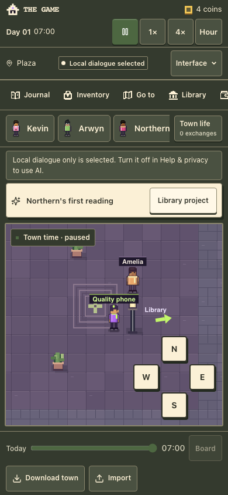
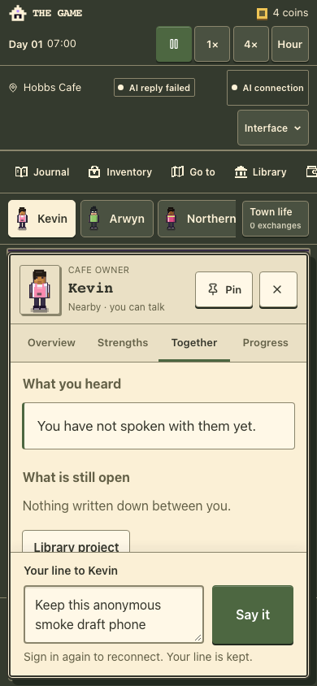

# Explicit player coin balances — 26 October 2026

[PR #45](https://github.com/arwyn6969/the-game/pull/45) is refreshed onto main
`4a5ae77d531b984320203daa86449c168bd0fe15`, preserving the current AI recovery,
meetings, manuscript, interface and hosting features. Runtime merge `39d048f`
changes only the original player balance copy: “4 coins”, “1 coin”, and the same
unit in the player card and journal. Money, ledger rules and saves are unchanged.

Current typecheck, lint and the normal build pass with no database credentials
and migration skipped. The inherited unused auth-directive warning remains.
All 1,092 script tests, 55 typed tests, 425 town tests and diagnostics pass
locally. The final complete required Verify gate also passes, including all
browser, accessibility and authenticated-wallet gates.

[Browser results](browser-results.json) pass on desktop 1280×800 and phone
390×844. All three surfaces correctly show 0 coins, 1 coin, 4 coins and 120 coins,
fit the viewport and retain the actual amount after reload. Normal keyboard or
touch movement, pause, local dialogue and synthetic town download/import also
pass, with no JavaScript errors or horizontal page overflow. Screenshots were
inspected. These are disposable local contexts, with no existing browser state,
authenticated account or real provider call. Physical-device acceptance is not
claimed.

The original mismatched financial fixture was rejected by the save validator.
The corrected fresh-town fixtures have no prior ledger to contradict; import
initializes their declared opening balances normally. Product validation is
unchanged.

## Publication and CI recovery

The [first current-main run](https://github.com/arwyn6969/the-game/actions/runs/40392775932)
passed application/build/general UI/stamp checks, then caught `assertStopped`
reading localStorage before the serialized Web Locks save committed. It saw
`active`; the later failure snapshot already had `paused`. The helper now waits
for both the absent Stop control and durable paused state before retaining the
original assertion. No runtime behavior, timeout, late-response or no-replay
assertion changed. [All ten local meeting journeys](meeting-stop-save.json)
pass. The original shared dependency tree lacked `axe-core`; the checkout now
uses the existing complete installed tree matching its committed lockfile,
without changing packages or the product dependency tree.

The complete [final Verify](https://github.com/arwyn6969/the-game/actions/runs/40396181381)
passed at `ee9ea343a49b8462a360bd82d8631898f2525caf` before PR #45 merged as
`2e5de222ab0d190b6f49ee51fb0dbdd4707aa092`. The complete merged and verified
source trees match. The clean verified package is now existing Worker
**`82c1f2d0-dcf5-4387-8934-549a7ba267f2`**, preserving AI recovery PR #56.

[Published receipts](published-checks.json) show all four live client hashes
matching, successful game/privacy/session/manifest/canonical links, and all 18
binding definitions plus runtime settings unchanged. No secret values were read
or uploaded and no migration/provider change occurred. A code rollback to
`673fe14a-ba0f-450c-87bb-dc4cd96130c2` retains the AI fix with the older wording.

Actual hosted desktop and phone contexts verify “4 coins” in the header, own
card and journal. Each makes one deliberately unauthorized player POST, checks
the real serialized rejection and fresh null session, dismisses/reopens the AI
notice, preserves its draft/world and records no replay over the 16-second poll,
JavaScript error or unexpected mutation. These fresh anonymous contexts do not
read a user profile/town, start OAuth or call a model. They do not claim physical
device or fresh authenticated provider acceptance.

