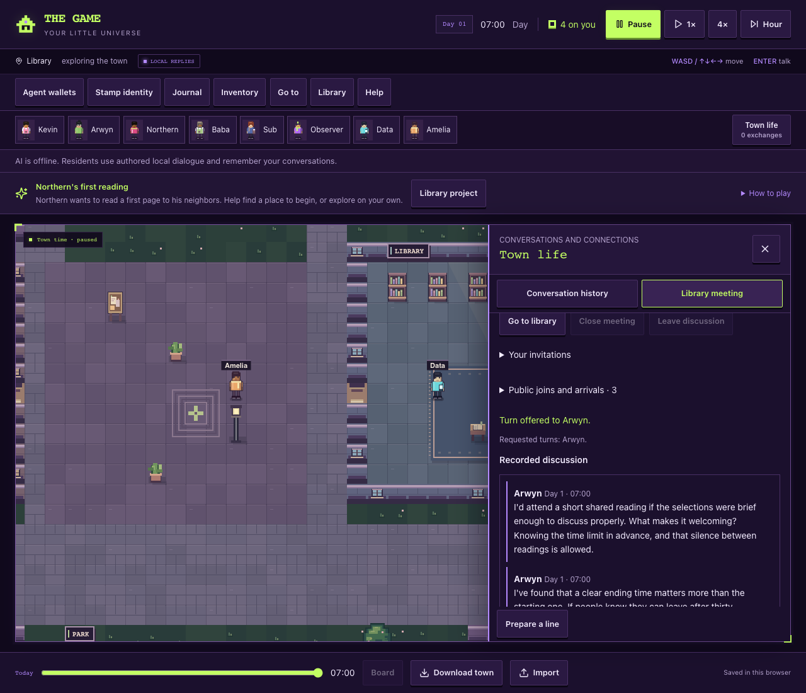
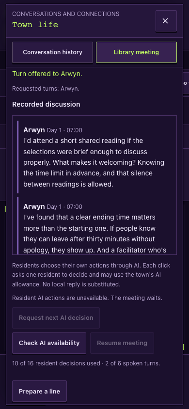

# Arwyn meeting — real-speech opt-in delivery verified

22 October 2026. The user explicitly requested another local meeting with Arwyn invited to facilitate and the remaining free calls used to test opt-in listening, with production unchanged. This continues [draft PR #44](https://github.com/arwyn6969/the-game/pull/44) after [Northern's actual refusal](../library-meeting-real-ai-2026-10-22/README.md). The first trial's evidence is preserved.

## Result and scope

**Two actual Arwyn statements passed the recipient, attributed-memory and actor-scoped-knowledge audit at source `7d869eee66e8c0783e53939458d8359fd66ebaee`.** The player received no earlier words when joining late. Sub and Baba received neither statement, despite being nearby. The speaker retained his own attributed statements separately from the recipient lists.

| Actual turn | Attentive recipients recorded at commitment | Nearby residents receiving no speech memory |
| ----------- | ------------------------------------------- | ------------------------------------------- |
| 1 · Arwyn   | Northern                                    | Player, Sub, Baba                           |
| 2 · Arwyn   | Northern, player, after explicit `listen`   | Sub, Baba                                   |

Northern has both attributed turns, the player has only turn 2, and Sub and Baba have no discussion-speech memories or received-turn context. Kevin, Data and Amelia also have none. Invitation memories remain separate from speech knowledge. After turn 2 the player successfully chose `stop-listening`; the next model request failed before producing words, so **real speech after stopping remains unqualified**, rather than being marked successful from an empty response. Reload preserves these exact knowledge boundaries and recipient receipts; finances remain unchanged.

Independent replay of the two actual speech results and the overload failure matched the saved meeting. It checked all eight scoped observations, the exact newly added attributed memories, no late-join backfill, unchanged finances and reloaded knowledge. The three transmitted prompt hashes, retained source/input hashes and prior manifested evidence matched. Inspection of a temporary ledger copy confirmed the original seven logical rows plus three new settled attempts, no outstanding reservations and the preserved unknown token samples. Actual prior ledger folders lack a full-tree byte baseline; immutability evidence covers the retained report/prompt/town hashes and copied logical rows, not an independent claim about every old ledger byte.

This was a **targeted probe of Arwyn's already granted floor**, following provider interruptions. It used the normal prompt, parser, freshness validation, executor and hearing delivery. The ordinary scheduler was preserved and would still ask Sub about attention before the floor. The result qualifies opt-in delivery for the two observed statements; it does **not** qualify an uninterrupted standard multi-agent discussion or later speech after stopping. No actor choice, listening state, turn or words were invented to obtain this result.

The last attempted response was HTTP 200 containing nested error **503**, “Upstream error from Nvidia: Service temporarily overloaded,” with no usable content or token/cost sample. The meeting is saved paused. No further model request is pending or scheduled, and no paid fallback was used.

| Accounting                                            | Actual result                                                                                               |
| ----------------------------------------------------- | ----------------------------------------------------------------------------------------------------------- |
| Arwyn meeting, all preserved stages                   | **10 attempts: 7 valid decisions and 3 empty responses**                                                    |
| Known meeting tokens / missing samples                | **9,010 known tokens; 3 unknown token samples**                                                             |
| Meeting AI wait                                       | **18.242 seconds**, excluding operator work and deliberate pacing                                           |
| Original approval, including earlier Northern refusal | **11 of 12 calls consumed; 1 left unused**                                                                  |
| Total known tokens across both meetings               | **10,243 plus 3 unknown samples**                                                                           |
| Local accounting                                      | Ten settled Arwyn budget/provider rows, no open reservation; all attempts counted                           |
| Reported cost                                         | $0 on the known responses; empty responses supply no cost sample; account monetary usage remains zero       |
| Final provider counter / inherited ceiling            | **33 used / 37 ceiling**; the allowance counts failed transmissions even when the provider counter does not |

The full [actual probe receipt](report.json), [retained source/input hashes](source-hashes.json) and [final read-only account snapshot](after-probe-preflight.json) preserve the measured result. Prompts, the exact synthetic saved town and copied SQL ledgers remain in ignored artifacts. The real model was `nvidia/nemotron-3-ultra-550b-a55b:free`; the current zero prices were verified before each run. There were no production configuration, quota, authentication, secret, shared-database, main-branch or deployment changes.

At the final source, Node 24 checks pass: **993 script + 55 typed tests; 415 town tests**, typecheck, lint with zero errors and one inherited warning, diagnostics and a credential-free build whose migration explicitly skipped with `DATABASE_URL` absent. The town tests overlap the script suite. Sixty-one focused engine/protocol/audit/operator tests pass. This is a positioned synthetic town using real AI and the actual engine; travel, physical devices, hosted sign-in/background availability and multi-speaker meeting quality are not established by this trial.

## Actual saved meeting in the interface

The [desktop/phone browser receipt](browser-receipt.json) imports the exact final synthetic town into disposable contexts at **1280×800 and 390×844**. Its input hash remains `6ed37506097dc4c66657b3573663bd117b508c6c58296dab9512052894e8ab8d`. It matches both actual attributed lines in the DOM, retains the complete saved discussion including recipient receipts, and shows the player as present but not listening. Normal Pause changes only the disposable view's clock setting; the source file remains unchanged. No inference or RPC is attempted, external font/platform requests and sockets are blocked, and neither viewport has page errors or horizontal overflow.

The offline banner in these screenshots reflects the capture's deliberately disabled transport. The words are the retained real-model responses, not replacement local dialogue. Watching this public observer transcript still does not grant character knowledge.

The actual town's undismissed guide and offline-status rows leave only **166 pixels** of meeting reading space at 1280×800. The receipt records that limitation and provides a supplemental 1280×1100 reading screenshot; phone reading space measured 641 pixels after scrolling the pane. The first capture's assumed 180-pixel minimum was inappropriate for this actual first-time UI state. The receipt harness now measures and records the limitation instead of treating screenshot capture as the prior synthetic layout gate. No product layout or saved guide flags were changed to make the capture pass.

## Initial real decisions and provider interruption

At source `3edcc6aed9576e400422f94833728f9f49a8570c`, Arwyn accepted the facilitator invitation; Northern and Sub accepted as participants; Arwyn then chose `participate`. On the fifth request, Northern's attention decision received HTTP 200 with empty content, no finish reason and no token report. The transport correctly rejected it as invalid/empty, returned `unreachable`, and paused the meeting without substituting a choice. No speech had yet occurred, so this stage does not qualify hearing.

The [initial machine receipt](initial-report.json) preserves **five transmitted attempts, four valid choices, 4,957 known tokens plus one unknown token sample, and 8.441 seconds of AI wait**. The four valid responses report $0 cost; the empty response reports no cost. Monetary usage on the provider account remains zero. All five local budget and provider rows settled; five attempts are known, with one token sample unknown. Finances and post-invitation memories remain unchanged; export/reload preserves the paused Arwyn meeting and all knowledge projections.

Independent read-only replay reproduced the saved meeting from the four real choices. Inspection of a temporary ledger copy found five settled budget/provider rows and no open reservations. The actual final town resumes through the core helper with the same meeting ID, five prior decisions and unchanged member choices; its old response becomes stale and Northern's new options remain leave, listen or participate. The [later provider snapshot](after-initial-preflight.json) reports 30 free requests used; the grant conservatively counts all five attempted transmissions regardless of the account counter.

Before resumption, the original twelve-call authorization had consumed **one Northern refusal + five Arwyn-stage requests = six calls**, leaving at most **six**. An explicit resumption of this same paused meeting used that remainder. It copied the closed ledger, loaded the saved actual town and used `resumeDiscussion`, preserving every NPC choice and memory. It created neither another meeting nor a fresh allowance. A further unavailable/invalid response paused again without automatic retry. [Initial source/input hashes](initial-source-hashes.json) retain the tested source and original evidence.

The [resume preflight](resume-preflight.json) records both original receipt hashes, six prior transmissions, six remaining calls, and the inherited ceiling of 37. Fifty-three combined engine/protocol/audit/runner tests pass, including the copied five-charge ledger, preserved loaded resident state, unknown token sample retention, a second empty response stopping safely, and a blocked replay through another output. Eleven focused runner tests and scoped lint pass. Independent core review found no remaining blocker. Schema-default normalization in the raw-versus-loaded memory comparison is covered without weakening the exact before/after-resume resident-state assertion.

## Same-meeting resumption and targeted speaking-turn check

The actual resumption at source `185d72b` loaded the saved Arwyn meeting and copied its five-charge ledger. Northern chose `listen` on its first new request, using 1,239 tokens. The next request, for Sub's attention, again returned HTTP 200 with empty content and no token/cost sample; the meeting paused. The [resume receipt](resume-report.json) and [source/input hashes](resume-source-hashes.json) retain **two new attempts, seven total Arwyn attempts, 6,196 known meeting tokens and two unknown samples**. All receipts still contain no speech. The original twelve-call grant has consumed eight attempts including Northern's earlier refusal, leaving at most four.

The final bounded check explicitly selected **Arwyn's already reserved speaking turn**, using up to those four remaining calls. It did not change the ordinary scheduler: Sub's pending attention decision normally precedes the floor and had hit provider failure. This targeted probe left Sub's actual mode off and Northern's real chosen listening on. The model could still speak, pass, stop, leave or close when legally offered. It used the same prompt, parser, freshness checks, mark/apply executor, recipient and memory audits. The report labels `targeted-floor-probe`; no NPC choice or dialogue was prescribed to get a successful-looking result.

The final probe verified all three prior receipt hashes, copied the seven-charge ledger, retained the eleven-call total Arwyn limit and account ceiling 37, and allowed at most four new transmissions. It actually used three. A one-use claim and exclusive output prevent resetting this remainder. The saved meeting resumed through the actual engine helper; no new meeting, invitations or acceptance were created. Prior report/prompt/town files remain covered by their retained hashes; original SQL ledgers were copied instead of opened for new writes.

The [targeted preflight](floor-preflight.json) records the exact chain and remaining four-call maximum. Nineteen combined runner/floor-helper tests pass with synthetic network only; scoped lint passes. The fixture checks a copied seven-charge ledger, original evidence preservation, one-use replay rejection, four-call/fixed-ceiling bounds, legal Arwyn floor selection while the ordinary scheduler still chooses Sub, a model pass stopping without coaxing, and redaction of bounded provider-error metadata. Core tests exercise actual executor freshness, Northern-only delivery, a late player listener, unchanged Sub-off memories, and invalid floor contexts. The targeted helper never changes the queue or grants a turn.

## Implementation and bounds

The proposed facilitator is now an optional engine parameter, `createLibraryDiscussion(town, topic, "arwyn")`; the existing two-argument API continues to propose Northern. Both must accept and choose attention themselves. Current role, quorum, closure, invitation wording and save validation use the actual proposed facilitator. No UI facilitator selector or forced NPC acceptance was added. The proposed host's membership comes first, so his delivered invitation is decided before spending calls on participants; existing scheduling and ignored-notice progression otherwise stay unchanged.

The [read-only preflight](preflight.json) carries the **original twelve-call approval minus one consumed request = at most eleven remaining calls**. It inherits the original account ceiling of **37**, rather than adding twelve to today's new counter. If other usage reduces headroom, this experiment shrinks to the available calls. The original receipt must be complete, closed, settled and from the same UTC day. It cannot be combined with a fresh allowance. Its byte hash binds a single-use continuation claim outside the original evidence folder. A second output path cannot restart that remaining allowance.

The initial Arwyn output is `artifacts/library-meeting-real-ai-20261022-arwyn-once/`. The explicit same-meeting resume uses a separate fixed output and a copy of that ledger. Other bounds remain: synthetic town, existing free Ultra model, one attempt per dispatched job, 1,200 output tokens, twelve-second deadline, 31-second pacing, local SQL budget/quota ledger, no paid fallback or production request. All NPC decisions and speech remain real model choices. Closure, silence or exhaustion ends generation; unavailable or invalid output pauses without automatic retry or invented continuation. The one explicit operator resume preserves the paused meeting's actual state and remaining allowance.

The player remains off for the first actual spoken turn, listens after it and stops after the next if those turns occur. Baba is a nearby inattentive nonmember. Every utterance must pass the actual recipient, attributed-memory and actor-scoped-observation audit; previous receipts cannot change. Reload may not backfill knowledge. Zero or too few spoken turns leaves corresponding hearing cases unqualified.

Before the initial stage, **50 focused engine/protocol/audit/runner tests passed**, including Arwyn's voluntary acceptance versus attention, actual quorum, scoped speech, nonhost decline, host decline, save role corruption, default Northern compatibility, remaining-budget bounds, unknown prices, preserved old evidence and a blocked continuation replay through another output. Integrated Node 24 checks also passed: **982 script + 55 typed tests, 415 town tests**, typecheck, lint with zero errors and one inherited unused-disable warning, diagnostics and a credential-free build with `DATABASE_URL` absent and migration explicitly skipped. The town tests overlap the script suite. Independent continuation review found no blocker. Resume-specific validation is recorded with the resumed outcome.
