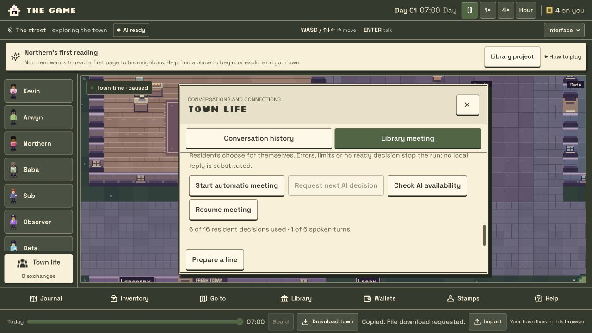

# Automatic library meetings — 25 October 2026

The Library meeting panel now has one explicit **Start automatic meeting** control. New proposals default to Arwyn as facilitator. The existing resident scheduler chooses actions without a click for each decision. Residents can decline, listen, volunteer, pass, leave or close; the runner does not assign their choices.

The game must stay open and visible. Stop, town Pause, hiding or leaving the page, reload, import/replay, a save or AI failure, unavailable AI and quota limits stop automatic requests until an explicit Start. Waiting for a player turn or accepted arrivals uses no AI call. Actual heard speech can offer a listener one new choice. An idle all-listening meeting stops without repeated polling or invented dialogue.

Meeting and manuscript requests wait at least 31 seconds after the last physical AI request starts. While the automatic meeting owns the lane, ordinary jobs use existing local results and no background AI request is sent. The global transport lock remains held until an underlying request actually settles, including after Stop or timeout.

The release preserves the free-only model route, authentication, shared/player/provider limits, zero monetary controls, six spoken turns and sixteen meeting decisions. No migration, save-schema change, secret upload or provider-configuration change is included.

## Source and checks

- Source: `e019735f8707624787ea38b4a147734dcea22b82`, [PR #52](https://github.com/arwyn6969/the-game/pull/52), based on main `6f890add7968002a59aee3ebd506f7f6129479cd`. Application code is identical to independently reviewed `99bb29c`; subsequent changes correct synthetic schedules and shared-clock pacing in browser acceptance.
- Node 24 local tests: 1,073 script + 55 typed tests, 425 town tests, typecheck, lint (one inherited auth warning), diagnostics. Independent final review reran 43 focused lifecycle/attention/core tests.
- Both final credential-free builds passed; the normal build explicitly skipped migrations because `DATABASE_URL` was absent. Cloudflare packaging dry-run passed.
- Actual CUA checks used normal UI imports/exports at desktop 1280×800 and phone 390×844 with labelled synthetic transport. Five uninterrupted final-phone decisions produced three lines and a synthetic facilitator close; starts were at least 31 seconds apart with no overlap or non-discussion invocation during the meeting. Two ordinary mock talk requests after close are reported separately.
- Independent saved-state audits verified audiences Sub/Sub/Arwyn in the final player-off run; player and the other five residents received no meeting content. Earlier desktop/phone runs verified the player received only the middle line after joining late and received nothing after stopping. Existing meeting knowledge survived reload. Ordinary town time may change economy bookkeeping; it is not evidence of a meeting payment.
- Browser regressions preserve manual meeting journeys and record every transport invocation while a real town tick processes stale plans. Actual held Web Locks test Pause and hidden-then-visible interruption while Start awaits durable save, with zero requests before a fresh explicit Start.
- Verify #157 correctly rejected a fixture expecting Sub to hear a line after ordinary movement had taken Sub away before accepting the invitation. The final fixture gives the three invitees normal current-day library plans while uninvolved residents retain stale plans. All original audience/cue assertions remain; no meeting choice or position changes mid-journey.
- Verify #158 passed every desktop journey and phone hearing/Stop/hidden checks, then timed out waiting for a phone restart. The harness advanced time from the last act while production correctly used the latest all-kind AI request. The corrected helper and assertion now use that shared clock, retaining the 30-second wait and all original checks. Safe timing/control receipts are saved before reload and on failures.
- All 18 projected production binding definitions match the prior version, including seven retained remote secret definitions whose values were not read. A wrong auth-origin value in an unpublished candidate was corrected before publication.

No real model call was made for this implementation's acceptance tests. These results establish scheduling, hearing, persistence and failure behavior; they do not claim a newly observed real-AI group conversation.

## Publication

Published at **https://www.arwyn.party/thegame/** on 25 October 2026. Runtime `e019735f8707`, Worker version `8a7d7405-031c-4502-91b1-208d9db5fa8e`; [PR #52](https://github.com/arwyn6969/the-game/pull/52) merged as `b4cc195ed3cb26d03aa3408b2b05d906363da464`. The merged main tree exactly matches the verified source tree. [Verify #159](https://github.com/arwyn6969/the-game/actions/runs/40146517763) passed every required check before merge/publication. Independent artifact review confirms all ten desktop/phone meeting journeys, 60 checked timing gaps with a 31,100 ms observed minimum, and thirteen act-only invocations in each initial armed window.

All four public client asset hashes match the prepared build. The game, privacy, anonymous auth session (null), mounted PWA manifest and existing homepage return successful responses. The published Worker retains all eighteen binding definitions and runtime compatibility settings exactly. No production migration, secret upload or real inference was made.

Normal UI downloads immediately before publication and after actual browser reload compare **the entire town equal**, including identity, choices, all memories and accounting. The same Arwyn meeting remains paused at six decisions/one saved line, pending null and player listening off. The new Start control is visible and enabled; it was not clicked.

Prior production version for rollback: `c66bb68a-7c96-414a-9a38-72e2d62766e9`. A code rollback cannot undo independently changed town or service data; this release makes no schema migration or production model request.

Raw towns, memories and transport receipts remain private ignored artifacts. Only a sanitized release receipt and appropriate UI screenshots should be committed.
