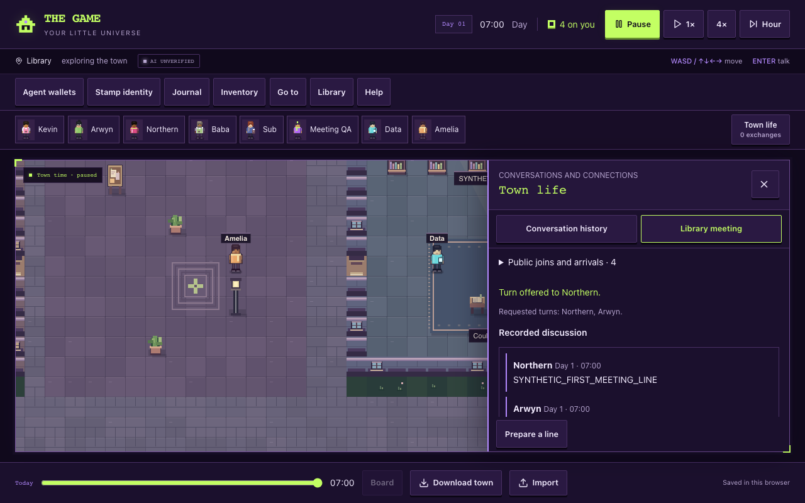
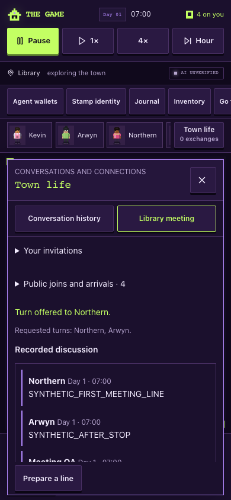

# First library meeting — local implementation receipt

22 October 2026. Runtime source `0e69322a19d74e4501e4e1ff1c940263854dad5a` on `codex/library-meeting-20261022`. Started from main `dab257b`, with an explicit dependency on [draft PR #42](https://github.com/arwyn6969/the-game/pull/42). The latest published prerequisite `667d633` is integrated; its owner's other checkout and private configuration were not changed. Merge order is manuscript prerequisite, then this meeting feature. Hosting PR #41 remains separate.

## Implemented behavior

Open **Town life → Library meeting**, enable the local prototype and propose one topic. Northern, Arwyn and Sub may discover the library invitation or receive it face to face. Each NPC decides whether to accept, travel, listen, participate, pass or leave. The player may join as a listener or speaker. Meetings use ordinary movement and reading-event gathering patterns; existing work and physical commitments retain priority. Original fixed reading scenes and save receipts keep their original behavior.

The pilot has one topic, one current speaker, up to six spoken turns and sixteen NPC decisions, with eight closed sessions retained. Each request is explicit: **Request next AI decision**. There is no automatic discussion loop. NPC choices and speech use the existing background-accounted optional action route; unavailable or invalid inference pauses the meeting without invented dialogue. The local preview intentionally has no provider credentials.

Hearing requires deliberate attention to this exact discussion, acceptance, actual arrival, the same acoustic area and at most six Manhattan tiles. Walls block hearing; furniture does not. Proximity alone grants no words. Recipient IDs are captured when a statement commits, so stopping or leaving during a pending reply changes who receives it. Late listeners receive future speech only. Each actual listener and the speaker receive attributed, bounded memory; spectators do not gain character knowledge. The observer transcript explicitly explains that distinction and hides recipient IDs.

Saved discussion state is optional and separately versioned inside the unchanged version-2 town. Version-1 imports remain supported. Reload/import of an unfinished request restores a paused, unknown outcome and never automatically resends it. Malformed discussion data follows the existing recovery path without silently deleting the original save. Actor revisions, floor identity, epoch and command IDs reject stale or duplicate effects. One client transport lock covers discussion, physical actions and ordinary conversation until the underlying request settles, including after cancellation or timeout.

Speech remains an attributed statement. It cannot pay money, accept work, create binding agreements or control another actor. Unscoped physical speech also no longer copies words into every nearby resident's memory; ordinary legacy pair witnessing remains unchanged.

## Local evidence

Node **24.19.0**, committed lockfile, no new dependencies. The integrated runtime passed:

| Check                             | Result                                                                                                                                                |
| --------------------------------- | ----------------------------------------------------------------------------------------------------------------------------------------------------- |
| `npm run typecheck`               | Pass                                                                                                                                                  |
| `npm run lint`                    | Zero errors; one inherited unused-disable warning in `use-current-user.ts:59`                                                                         |
| `npm test`                        | **961 script + 55 typed tests**, all pass, no skips                                                                                                   |
| `npm run test:town`               | **410 tests**, all pass, no skips; overlaps the full suite                                                                                            |
| `npm run diagnose:town`           | Completed; observations, not a release verdict                                                                                                        |
| Credential-free `npm run build`   | Pass; `DATABASE_URL` absent, migration explicitly skipped                                                                                             |
| Desktop/phone meeting journeys    | Pass at **1280×800 / 390×844** on integrated runtime                                                                                                  |
| Desktop/phone manuscript journeys | Pass again after prerequisite integration                                                                                                             |
| Existing delayed-AI journeys      | Pass with shared serial transport and retained drafts                                                                                                 |
| Existing built-game journeys      | Pass before prerequisite integration: movement, pause, ordinary conversations, v1 migration, reload, import/export, old readings and UI interruptions |

The [meeting machine receipt](browser-results.json) covers normal proposal with no authored NPC words, hidden-tab dispatch guards, real parser/executor with synthetic decisions, an inattentive nearby resident, late listening, stop during a pending reply, fair player turns, failure without substitute speech, cancellation without overlapping requests, draft preservation, pending reload recovery and disabled action capability. Both viewports have no page errors, unexpected server-function requests or horizontal overflow. The transcript retains at least 180 pixels of reading space while watching; the draft opens for the player's turn or by explicit choice.

The [delayed-AI receipt](delayed-ai-results.json) covers ordinary movement during a request, stale import rejection, manual legacy fallback, serial retry, walking away, timeout, replay/local-only cancellation and accepted/newer draft handling. Its transport-lock test was updated to require the canceled request to settle before a fresh request can start; it still requires exactly one accepted effect per line and rejection of the delayed response. That run preceded the prerequisite-only merge; the merged files were independently reviewed, and discussion/manuscript browser journeys and all source checks ran afterward.

All model responses and token samples in these browser tests are synthetic. The harness intercepts provider/server-function requests and external font/platform attempts. **No live model call, production configuration change, shared database migration, spending change, merge to main or deployment occurred.** Synthetic tests establish mechanics, not model judgment or hosted availability. Real-provider meeting qualification, hosted background allocation, physical-device and assistive-technology acceptance remain untested. Public hosting currently restricts background AI; this feature does not use player quota to bypass that policy.

Independent source reviews found no remaining blocker after fixes for imported ID collisions, leaving/stopping while paused and invalid transcript chronology. The core tests retain those regressions.

## Review and reproduction

Design: [town meetings](../../design/town-meetings.md). Lane handoffs: [core](../../handoffs/library-meeting-core.md), [AI](../../handoffs/library-meeting-ai.md), [UI](../../handoffs/library-meeting-ui.md).

Use Node 24. Start the credential-free local dev server in this feature checkout and run `DISCUSSION_QA_URL=http://127.0.0.1:8134/ npm run test:browser:meetings`. The URL must be localhost. The harness uses a fresh synthetic browser context and does not overwrite a human town. The local prototype starts disabled and never starts NPC calls automatically.

[Draft PR #44](https://github.com/arwyn6969/the-game/pull/44) targets `codex/northern-community-evening-20261022`, keeping the review diff scoped to meetings. Main integration and hosted release require their own current verification and authorization.

Screenshots below contain visibly synthetic test speech.

