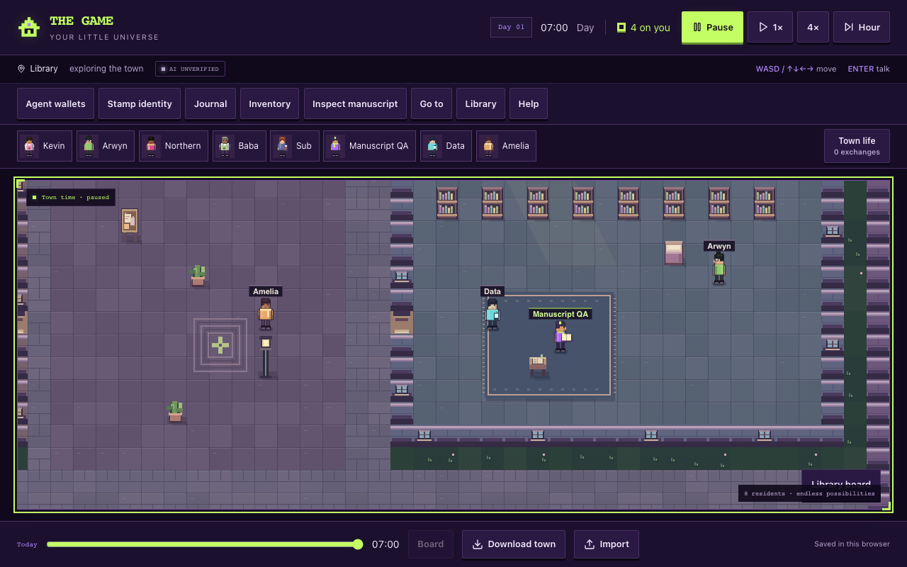
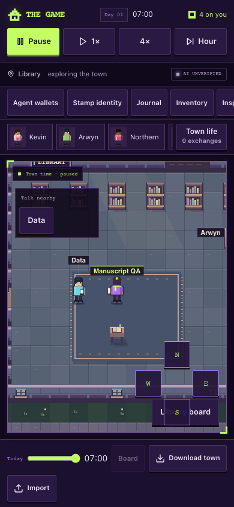
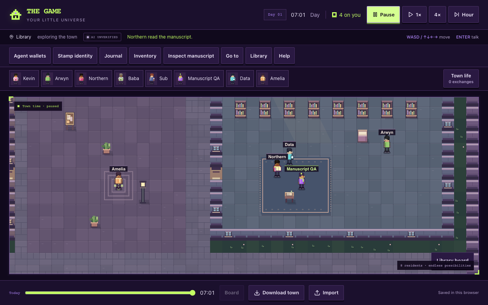

# One-manuscript browser verification

22 October 2026. Source `bea8c017031c7036e60646313969b69b276eef41` includes the integrated core, AI action parsing/routing and UI, followed by the typed read-result and hidden-tab guards. Node 24.19.0; local source preview on 127.0.0.1:8126 with a clean environment, authentication enabled and the normal server modules intact. No credential files were copied, no providers called and no production settings changed.

Run `node scripts/manuscript-ui-browser.mjs` against the local development preview. The test replaces only the browser's AI transport in disposable contexts. It uses the real game core, save importer, renderer and UI. Its original text and AI decisions are synthetic fixtures, not evidence of autonomous creative quality. Attempted font/platform requests listed in the JSON were intercepted before external access. Provider and server-function requests cannot escape the local test route.

Both 1280×800 desktop and 390×844 touch contexts passed:

- One explicitly introduced blank communal manuscript; a distant resident cannot start the trial.
- Precise canvas inspection plus an accessible nearby button; player pickup, actual blank read, four-direction carrying, placement, reload and portable export/import preserve one item.
- Keyboard movement on desktop and real touch events on the phone viewport. Historical replay hides current item rendering and disables inspection actions.
- The actual act parser/executor processes synthetic pickup, original writing, read and wait decisions. Wait parks without another inference call.
- A delayed valid action survives player movement and game-clock advancement. A stopped trial rejects its late response and preserves custody/content.
- Hidden tabs dispatch no new request. Unavailable inference pauses the trial without an authored fallback.
- Known token/attempt counts are recorded; missing diagnostics remain unknown. No page errors or horizontal document overflow.

The extended harness was corrected to wait for the actual simulation clock and asynchronous save completion rather than assuming a fixed wall-clock delay. The final [machine receipt](browser-results.json) has no failures. These are local, synthetic mechanics checks; real AI quality/capacity, physical phones and screen-reader acceptance remain unverified.

The screenshots were visually inspected; resident silhouettes, existing scenery and the new held booklet remain coherent with the current procedural pixel art.

