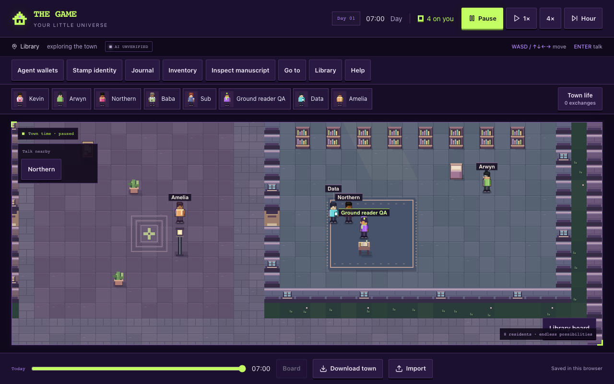
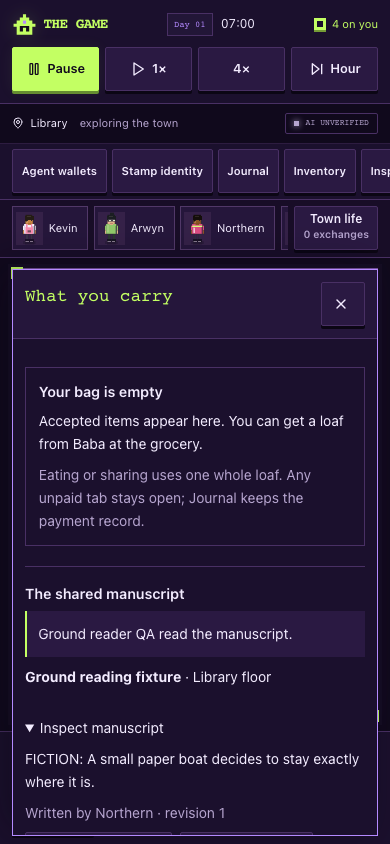

# Adjacent-ground manuscript reading — browser evidence

22 October 2026. Integrated source `457322c7a835126bbc68a5c1c5b5f8f72ad6db24` contains core helper/executor `7a5142b`, UI Read controls and state-aware prompt `a311124`. This check used Node 24 and a clean local source preview at 127.0.0.1:8126, authentication enabled, no provider credentials, and a disposable browser-only synthetic AI transport. The real core, renderer, save/import code and UI were exercised. No live provider call occurred.

Both 1280×800 desktop and 390×844 touch contexts passed:

- Actual Read commands from the same ground tile and a cardinal-adjacent tile reveal the saved original text without picking up the manuscript.
- The complete item remains identical before/after: ground location, author, content and revisions. The paused canvas is byte-identical, so reading does not fabricate a held-book sprite or change the physical scene.
- Diagonal, three-tile-distant and another resident's held manuscript keep Read disabled and do not expose unread content.
- Keyboard conversation entry and close/reopen preserve the resident's unsent draft and item custody.
- Retained manuscript checks pass: introduction, nearby invitation guard, precise/accessible inspection, player pickup/read/place, four-direction keyboard/touch carrying, pause/replay, reload and portable import/export.
- Synthetic AI pickup/write/read/wait, bounded parking, late valid responses after player/clock changes, stop, hidden-tab guards, unavailable inference and known/unknown usage accounting still pass.
- No page errors or horizontal document overflow.

The [machine receipt](browser-results.json) includes the assertions. Attempted external font/platform requests listed there were intercepted before external access. Synthetic text/decisions exercise mechanics and do not qualify real-model judgment, physical phones or screen-reader usability.

Reproduction: `MANUSCRIPT_QA_OUT=artifacts/manuscript-ground-read node scripts/manuscript-ui-browser.mjs` against the local development preview. The local server and test browser require ordinary localhost/process permissions on this machine. Product authentication was not disabled.

