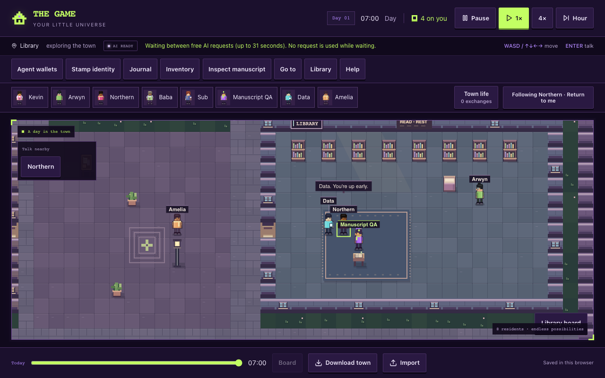
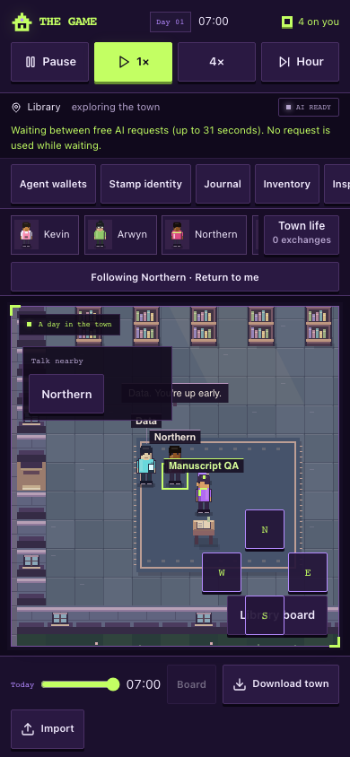
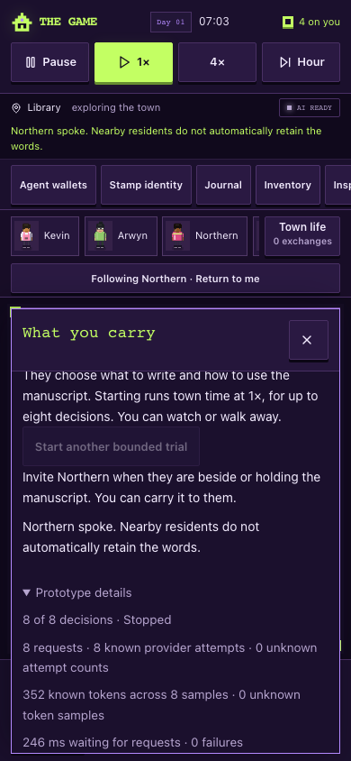

# Physical request cadence — browser acceptance

23 October 2026. Tested source **`a3a34af556e2baf535af71658f0b4dfa733fe296`**, runtime cadence **`b002e362e157af43788349a8c2ae840243c24d92`**, on the current main-based speech-continuation candidate. Only the browser harness was dirty at launch. This evidence packet contains no runtime edits.

Actual **1280×800 desktop** and **390×844 touch** browser journeys pass using Playwright's virtual clock. The production **31,000 ms** constant is unchanged. The clock replaces browser time APIs, including `performance.now()`, and jumps elapsed wall time between completed requests rather than waiting 31 real seconds for each decision. Every observed pair of physical request starts is asserted at least 31,000 ms apart. Pending calls are never advanced by the request helper.

The focused checks establish:

- After a supplied greeting, the trial remains enabled and free to choose another action. At **28,002 ms desktop / 28,000 ms phone** after the first start, there is still one request, one decision and one synthetic 44-token sample. Waiting has not marked another request or changed usage. The UI explains the free-AI wait.
- Advancing beyond the real interval permits the next request; its separately supplied read decision succeeds. Explicit wait then parks the trial, including after another complete interval.
- Stop followed by an explicitly started new trial does **not** reset the mounted tab's cadence. Before the original deadline, the new trial has zero decisions, requests and known tokens. Hiding the tab past the deadline still dispatches nothing; showing it allows the next request. No timing override or authored replacement is used.
- Eight speech decisions stop at eight requests, including after another interval; no ninth starts. Pending post-speech reload retains its honest unknown sample without resuming. Stopped delayed responses remain ineffective after another interval.

The retained full manuscript journeys also pass: one pending transport; no invented Data reply; no proximity-granted speech memories and unchanged meeting state; enabled product authentication; duplicate-read pause and preserved accounting; manual player rereading; ground reach/custody rules; conversation drafts; keyboard/touch movement; replay; reload/export/import; valid late response after player/time changes; hidden tabs; and unavailable inference without fallback. Both viewports have no page errors or horizontal document overflow.

The [machine receipt](browser-results.json) records the source, virtual clock, counts and both viewport journeys. This used the real UI, prompt/parser, physical engine, rendering and saves, with browser-only synthetic transport. The local source server ran with authentication enabled, no database/provider credentials, and external requests intercepted. **Zero live AI calls.** Synthetic token fixtures are accounting checks, not provider compute measurements. Hosted sign-in, physical phones and provider load are outside this receipt.

Scoped ESLint and diff whitespace checks pass. Reproduction against the clean local source preview: `MANUSCRIPT_QA_OUT=artifacts/manuscript-live-cadence node scripts/manuscript-ui-browser.mjs`.

