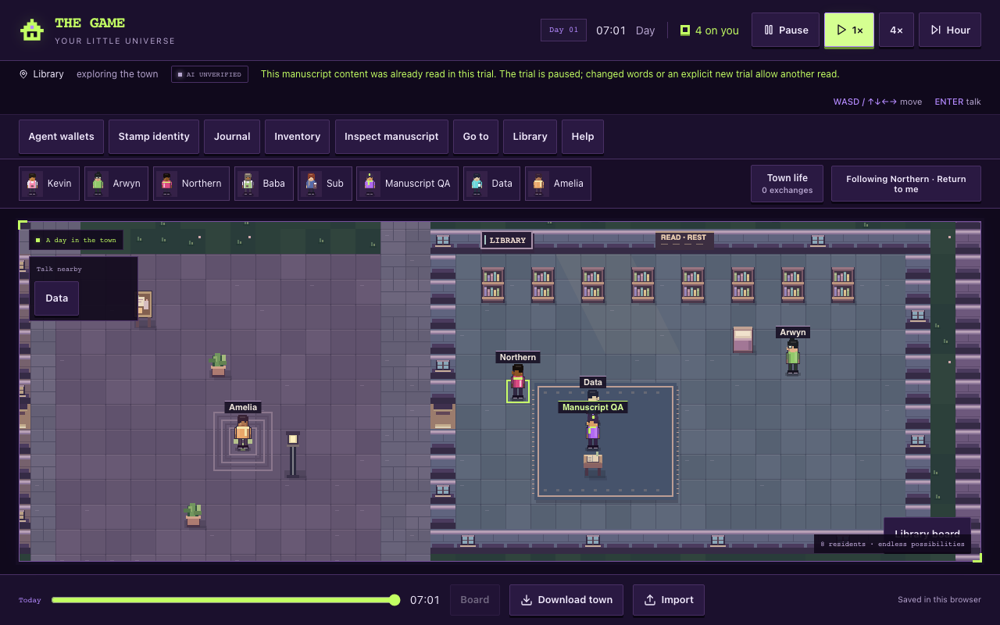
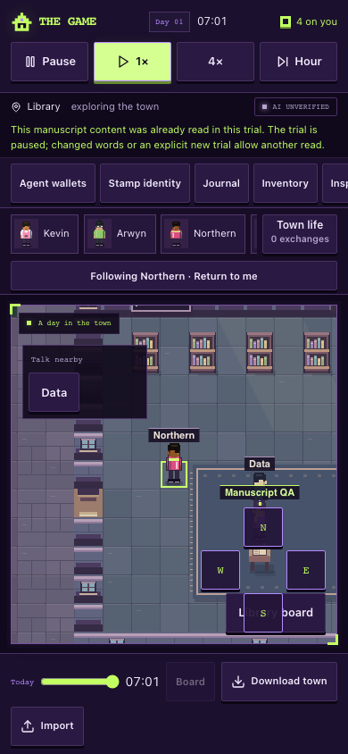
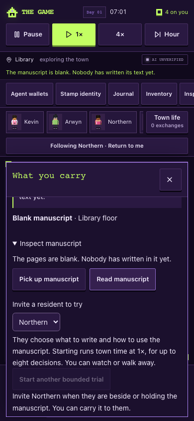

# Unchanged-read pause — browser acceptance

22 October 2026. Runtime source `9e399801` was merged into the UI lane as `d8f0dc15f43ea378a264ab7d93496637ee1207ee`. This packet changes the browser harness and records its evidence; it contains no runtime UI changes. The local source preview at 127.0.0.1:8126 ran on Node 24 with authentication enabled and no provider credentials. Browser-only synthetic transport exercised the real prompt, parser, controller, physical engine, renderer and saves. No live inference or external request was transmitted.

Both **1280×800 desktop** and **390×844 touch** contexts passed the focused sequence:

1. Northern actually reads the blank ground manuscript once through the controller.
2. The next AI prompt contains the known blank text and content revision zero, omits the read option, and still offers wait. Its projected last result does not duplicate full content.
3. The synthetic model deliberately submits the same omitted read proposal. The controller shows the factual pause reason. The item and reading pose are unchanged, and Northern still has exactly one read event with the same identity, timestamp and contents.
4. Two requests and two known attempts remain counted, with two synthetic 44-token samples (88 known tokens). No third call is dispatched while town time continues.
5. The player deliberately clicks Read twice on the same unchanged ground pages. Both succeed, preserve custody and NPC usage, and do not restart the NPC trial.
6. Reload preserves the paused controller, read receipt and two-request count, with no automatic request.

The retained journeys also pass: same/cardinal ground reading without transfer or a phantom held sprite; diagonal/distant/other-held denial; conversation draft preservation; introduction and invitation guard; precise and accessible inspection; four-direction keyboard/touch carrying; pause/replay; reload/export/import; synthetic AI pickup/write/read/wait; late valid response after player/time changes; explicit stop; hidden-tab dispatch guard; unavailable inference without fallback; and known/unknown accounting. Neither viewport produced page errors or horizontal document overflow.

The [machine receipt](browser-results.json) records both journeys and the focused accounting. External font/platform attempts listed there were intercepted. All decision text and token samples are synthetic; this checks mechanics, not model judgment or provider compute. Physical-device and screen-reader testing was not performed.

The first execution reached the expected pause, then its new receipt assertion compared optional memory flags added by existing save normalization. The harness now compares read event identity, timestamp, source and text; the complete rerun passed. Scoped ESLint and `git diff --check` also passed. No runtime code was changed to satisfy the test, and no broad suite was repeated.

Reproduction against the credential-free local source preview: `MANUSCRIPT_QA_OUT=artifacts/manuscript-read-progress node scripts/manuscript-ui-browser.mjs`.

