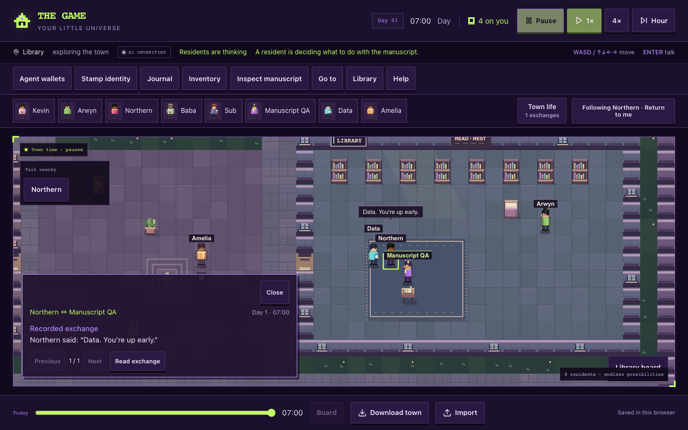
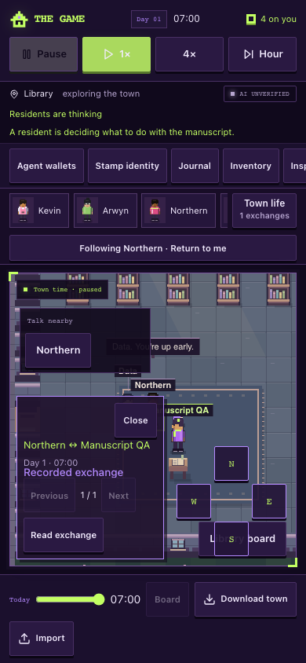
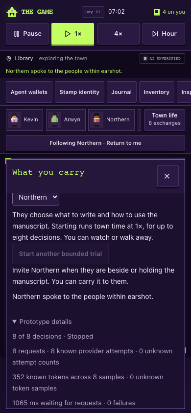

# Speech continuation — browser acceptance

23 October 2026. UI-lane source `cbb0506d9e34bcef3dada7c55a9d8e34b9c720c8` combines root baseline `c2f35b3` and speech-continuation core `4ebdb78`. This packet changes only the browser harness and its evidence. Existing UI wording already says the resident chooses for up to eight decisions; it does not claim that ordinary speech stops the trial, so no runtime UI wording was changed.

The local Node 24 source preview at 127.0.0.1:8126 ran with authentication enabled and no provider credentials. A disposable browser-only synthetic transport exercised the actual prompt, parser, controller, physical engine, rendering and save/import code. External font/platform requests were intercepted. No live provider request or credential was used.

Both **1280×800 desktop** and **390×844 touch** passed:

- **Greeting continues:** The first supplied response says “Data. You're up early.” Northern's actual bubble contains those words. A second model request follows automatically; the blank ground manuscript is unchanged, no pickup/read occurs implicitly, and Data's bubble remains unchanged. The second prompt contains the successful speech result and current action options. The global clock is then paused to hold that pending request while inspecting it.
- **Next action remains a model proposal:** A separately supplied read command succeeds on the ground manuscript. After resuming time, a third supplied response chooses wait. No fourth request occurs; the enabled session remains parked with three counted requests and 132 synthetic known tokens.
- **Speech respects the cap:** Eight separately supplied speech responses continue within the original allowance. After the eighth, the session is disabled, the UI's opt-in details show “8 of 8 decisions · Stopped,” and no ninth request occurs. Eight requests, eight known attempts and 352 synthetic known tokens remain recorded. The manuscript stays blank at its original ground location.
- **Pending reload stays honest:** Reload during the second request after a greeting preserves two requests, one known attempt, one unknown attempt and token sample, and the pending marker. It does not infer a result, restart inference or move the manuscript.

All retained journeys pass: unchanged-read suppression and visible duplicate pause; known words without a second read effect; deliberate player rereading; ground-read reach/custody rules; conversation draft preservation; introduction and nearby invitation guard; keyboard/touch carrying in four directions; pause/replay; reload/export/import; delayed valid response after player/time changes; explicit stop; hidden-tab dispatch guard; unavailable inference without fallback; and known/unknown usage accounting. Both contexts have no page errors or horizontal document overflow.

The [machine receipt](browser-results.json) contains both viewport journeys and the speech/read accounting. Token samples are synthetic 44-token fixtures, not provider compute. This qualifies controller mechanics rather than real-model usefulness, physical-device behavior or screen-reader usability. Scoped ESLint and `git diff --check` passed; no broad suite was repeated in this UI lane.

Reproduction against the local credential-free source preview: `MANUSCRIPT_QA_OUT=artifacts/manuscript-speech-continuation node scripts/manuscript-ui-browser.mjs`.

