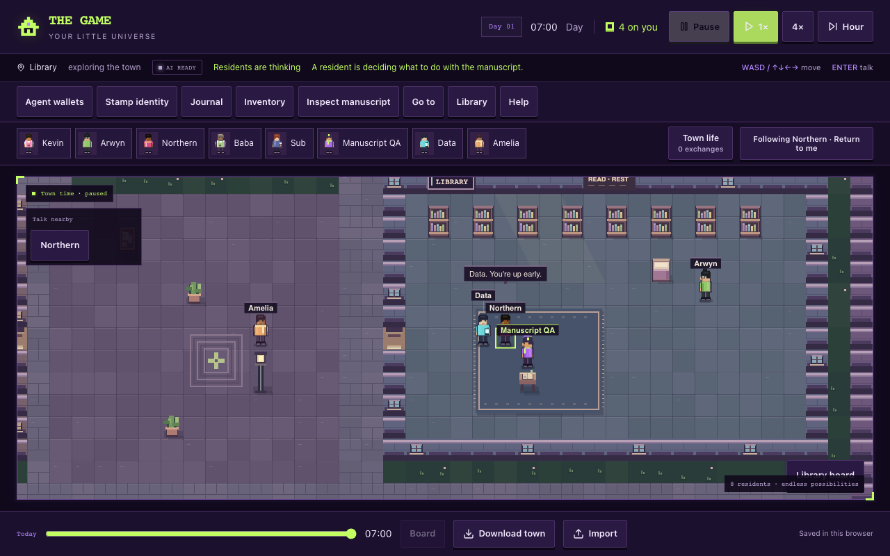
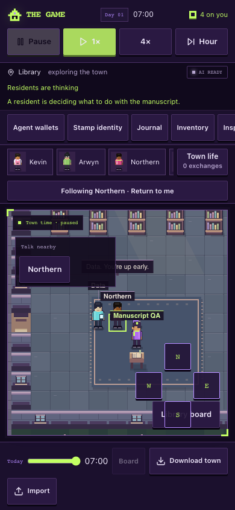
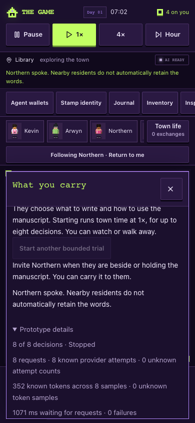

# Speech continuation on current main — browser acceptance

23 October 2026. This is new acceptance of the fresh main-based candidate, not a relabeling of the older `cbb0506` UI receipt. Tested head: **`4f04f32fdd2c11dbef871daeaec9e1e939721aab`**, runtime equivalent to `ec61792`, based on merged main `f7d5ae5`. Current main's hosting, availability recovery, deliberate listening and library meeting code remain present. At launch, tracked changes were the browser harness and three documentation files; the [machine receipt](browser-results.json) records their paths. No runtime file was edited for this acceptance.

The actual source preview ran on Node 24 at 127.0.0.1:8126, using a clean environment with `VITE_AUTH_ENABLED=true` and no database or provider credentials. Both browsers independently imported the real auth client and asserted authentication remained enabled. Only the AI transport was replaced in the disposable browser; all external font/platform attempts were intercepted. No provider request was made.

Both **1280×800 desktop** and **390×844 touch** passed the full manuscript journey, including:

- Northern's supplied greeting leads to a second model request. While that response remains pending, no extra transport starts. The manuscript stays on the ground and unread until a separately supplied read command arrives.
- Data is actually nearby, yet neither Data, the player nor any other non-speaker receives a memory containing the greeting. Data has no invented reply, and discussion state stays unchanged. This checks saved agent knowledge and meeting-state isolation; the observer can still see the existing physical speech bubble.
- A separately supplied ground-read decision succeeds, followed by explicit wait. The trial parks at three requests and 132 synthetic known tokens, with no fourth call.
- Eight separately supplied speech decisions consume exactly the eight-decision allowance. The UI details show “8 of 8 decisions · Stopped,” the manuscript is unchanged, and no ninth call starts. All eight attempts and 352 synthetic known tokens remain counted.
- Reload during the pending post-speech request preserves its pending marker, two-request count and unknown second sample, with no inferred response or automatic restart.

The retained checks also pass: unchanged-read option suppression and visible duplicate pause; one actual NPC read event and preserved accounting; deliberate manual player rereading; same/cardinal ground reach without transfer or a held sprite; diagonal/distant/other-held denial; conversation drafts; introduction/invitation guards; keyboard/touch carrying; pause/replay; reload/export/import; delayed valid responses after player/time changes; stop; hidden-tab dispatch; unavailable inference without fallback; and known/unknown usage. No page errors or horizontal document overflow occurred.

Scoped harness ESLint and diff whitespace checks pass. The first browser invocation raced server startup and stopped at connection refusal before loading the app; the complete rerun after Vite reported ready passed. The older receipt remains unchanged. These synthetic decisions and 44-token samples qualify controller mechanics, not real-model usefulness or provider compute. This does not repeat the full meeting lifecycle, deployed sign-in, physical-device or assistive-technology acceptance.

Reproduction against the clean local source preview: `MANUSCRIPT_QA_OUT=artifacts/manuscript-speech-main-integration node scripts/manuscript-ui-browser.mjs`.

