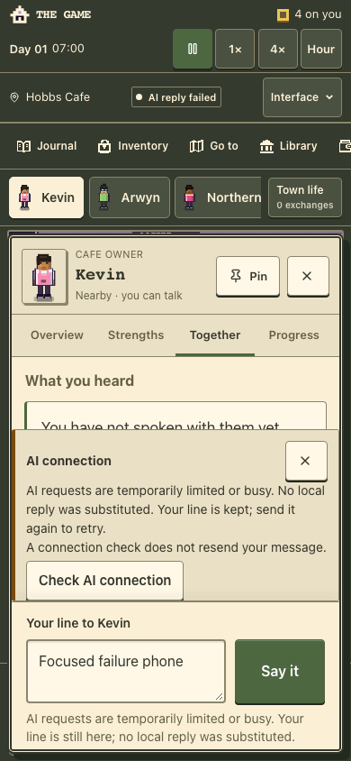
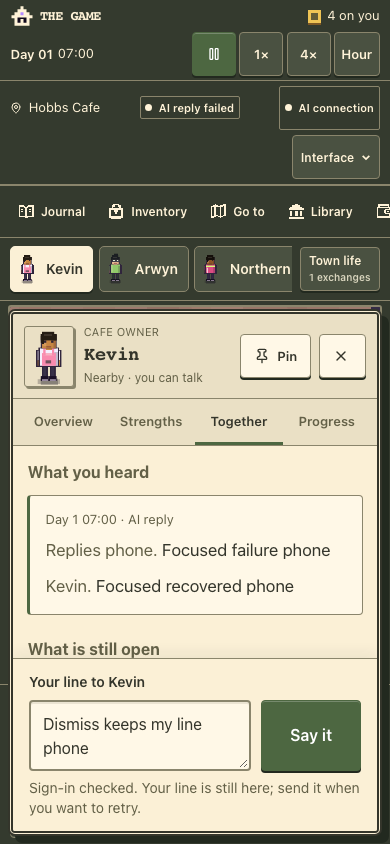
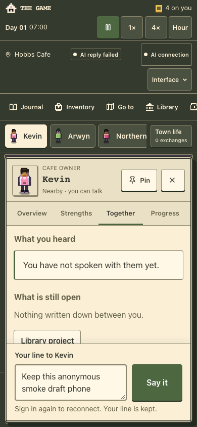

# Mobile AI failure and dismissible connection notice — 26 October 2026

Candidate branch: `codex/mobile-ai-warning-20261026`, based on current main
`66d161d343dedb411c0a3fdfc0dc55cbf44952e4`. Runtime source `520a9c418f352bb3dbaca97994cbf017df84cf80`,
[draft PR #56](https://github.com/arwyn6969/the-game/pull/56). This change is not deployed.

Production records confirm successful player replies, followed by one call
blocked before provider transmission while the two-per-minute window was full,
and a later HTTP-200 response-body failure after 11.8 seconds. The latter is
consistent with the 12-second deadline; the historical ledger cannot establish
the discarded exception category. [Details and boundaries](../../handoffs/mobile-ai-warning-2026-10-26.md).

The notice can be closed and reopened, retains drafts and the real failure
status, and stays dismissed through connection polling and a late check.
Connection-check feedback now explains that sign-in and configuration checks do
not verify an actual reply or available limits. Future provider timeouts retain
their category. The provider, free-only routing, budgets and deadlines remain
unchanged.

Node 24 verification:

- Typecheck and lint pass, with one inherited unused auth-directive warning.
- All 1,092 script tests pass with four workers and local listener permission;
  all 55 typed tests pass. The first sandboxed/default-concurrency run hit three
  denied local listeners, Vite module transport timeouts and a subprocess
  deadline; no assertion was removed. The complete bounded-concurrency rerun
  passed without skips.
- All 425 town tests pass. Town diagnostics complete (observations, not a
  release verdict).
- Two added provider tests exercise timeout before headers and during an
  HTTP-200 body, proving one settled attempt, unknown token usage and no extra
  request. The focused provider/status suite passes 37 tests.
- Browser verification uses disposable desktop 1280×800 and phone 390×844
  contexts, synthetic authentication and AI transport, and zero real inference.
  It checks dismissal/reopen, 44px touch controls, draft retention, late checks,
  polling, same-kind new errors, explicit resend, expired-session recovery,
  stale checks, movement, pause, reload and town import. Both full journeys pass, including HTTP-200 body-timeout feedback and the
  existing delayed-response/replay protections. A final focused pass also checks
  reopening from Overview and actual town downloads with matching world IDs.
- Both final credential-free builds pass; the normal build explicitly skips
  migrations because `DATABASE_URL` is unset.

The first browser run caught the original sticky warning overlapping Send after
adding the dismiss control. A subsequent nonsticky attempt clipped the header
inside the scrolled composer. The final layout gives the warning a separate flex
area, retaining geometry assertions and testing actual pointer clicks.

Private raw receipts remain ignored under `artifacts/mobile-ai-warning-20261026/`
and `/private/tmp/the-game-mobile-ai-*.log`. No existing browser profile, town,
OAuth account, production configuration or secret was changed. Physical-device
acceptance and a fresh live AI reply are not claimed.

[Sanitized final browser results](browser-results.json) record both viewports,
zero model calls, no unexpected network requests and no JavaScript errors.

## Publication

The user authorized merge/publication on 26 October. Current-head [Verify](https://github.com/arwyn6969/the-game/actions/runs/40382182700)
passed on `c88c90059389161ba240652a833a968550b3c23f` before [PR #56](https://github.com/arwyn6969/the-game/pull/56)
merged as `4a5ae77d531b984320203daa86449c168bd0fe15`. The complete trees match.
That clean archived source, built for the existing production identity, is now
Worker **`673fe14a-ba0f-450c-87bb-dc4cd96130c2`**. Earlier candidate statements
above describe pre-publication verification.

All 18 binding definitions and runtime settings are identical. No secret values
were read or uploaded; Wrangler refreshed the existing login and retained the
remote variables/secrets. Public checks match all four client asset hashes and
pass game/privacy/session/manifest and canonical routing checks.

Actual hosted desktop and phone contexts use fresh anonymous state. Each made
exactly one player POST, rejected by real auth middleware, then confirmed the
fresh null session, dismiss/reopen controls and preserved draft/world identity.
The warning remained hidden across the 16-second poll, with no second POST,
OAuth start, unexpected mutation or JavaScript error. This exercises the deployed
failure UI without model inference or existing user browser data. It does not
qualify a fresh authenticated model response or a physical-device session.

[Published receipts](published-checks.json). Previous Worker
`14548f3b-b385-4cc9-b4fe-db05ac5e5676` is the code rollback point. The release
made no database or browser-data migration. Coin-label integration remains a
separate follow-up.

