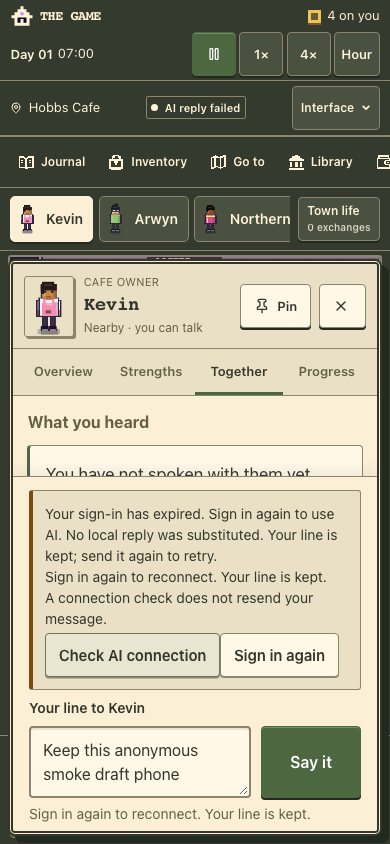

# Mobile session recovery — 26 October 2026

Published at **https://www.arwyn.party/thegame/**. The short link
**https://arwyn.party/thegame** now reaches the same game, including bare paths
with query strings. The game retains its established www sign-in and storage
origin.

Source `b41eeebab2bb56926a65084fde7cb35da592d8cc` passed every required
[Verify check](https://github.com/arwyn6969/the-game/actions/runs/40328592346)
before [PR #54](https://github.com/arwyn6969/the-game/pull/54) merged as
`66d161d343dedb411c0a3fdfc0dc55cbf44952e4`. The complete merged source tree
equals the verified PR head. The clean archived package was deployed to the
existing `the-game-production` Worker, version
`14548f3b-b385-4cc9-b4fe-db05ac5e5676`.

The recovery button now verifies the current uncached session, reports checking,
missing-session and transport outcomes, and offers explicit sign-in while
preserving unsent resident drafts. A check never replays a message, and a late
check cannot overwrite a newer response. Standalone hosting ignores preview
bearer tokens. The original immediate Chrome-on-iPhone login rejection was not
reproduced with an actual account; this release establishes the corrected
recovery behavior rather than claiming that device acceptance.

## Published checks

- All four public client asset hashes match the clean package. Game, privacy,
  PWA and anonymous-session endpoints pass; the manifest retains `/thegame/`
  for id, scope and start URL.
- All 18 game binding definitions and runtime settings compare identical before
  and after publication. Seven secret definitions were retained without reading
  or uploading their values. No migration, provider configuration change,
  purchase or real inference occurred.
- The new `the-game-link-redirect` Worker, version
  `1a44f41b-2b19-47d5-b0be-ca495abffbee`, adds only route
  `cdc62f1fbb6548fba198d5afa918ecd9` (`arwyn.party/thegame*`). All 51 previous
  route records are identical; there are now 52. Homepage and unrelated prefix
  responses retain their prior statuses, locations, release headers and body
  hashes. The redirect's public workers.dev and preview URLs are disabled.
- Public apex bare/slash, privacy, HTTP and query-bearing links reach www
  successfully. The alias's first 307 preserves the complete query; existing
  game routing may subsequently normalize duplicate query parameters. HEAD has
  an empty body; non-navigation game methods return 405 without replay.
- Actual deployed checks at 1280×800 and 390×844 used disposable anonymous
  contexts. Each made exactly one player POST and verified the real serialized
  `Unauthorized` rejection, sign-in action and fresh null-session feedback.
  Each draft and town identity remained, with no chat or automatic second POST
  across 16 seconds. There were no JavaScript errors or unexpected mutating
  requests. OAuth was not started and no credential or user browser state was
  copied.

Local Node 24 checks also passed 1,083 application script tests, 55 typed tests,
425 town tests, seven added redirect tests, typecheck, lint (one inherited
warning), diagnostics, credential-free builds and packaging. Full local
desktop/phone AI regressions used synthetic auth/AI responses, including
successful session recovery, stale-check races and draft restoration. The
final CI run includes the redirect tests and all browser, accessibility and
authenticated wallet gates. Its two annotations are GitHub runner/action
deprecation notices, not application failures.

One post-publication anonymous session HTTP read exceeded its 20-second client
deadline. A focused follow-up returned 200/null in 0.69 seconds, both actual
browser preflights passed, and the complete final public check passed. The first
timeout receipt remains preserved privately; its cause is unqualified.

## Rollback and evidence

Previous game version: `8a7d7405-031c-4502-91b1-208d9db5fa8e`. A code rollback
does not undo independent service or browser data; this release made no schema
or production town change. Redirect rollback removes only the newly added
route ID above, restoring the existing homepage route's handling. Keep every
old route and the homepage/game services intact. See the
[routing handoff](../../handoffs/mobile-routing-2026-10-26.md).

Publication and verification used the connected GitHub tools and the existing
Cloudflare API/Wrangler access. Cloudflare plugin discovery returned no provider
integration in this session; no dashboard login was required. The user's
plugin/API-first preference applies before future browser administration.

Ignored raw metadata, route backups, packages, HTTP and browser receipts remain
under `artifacts/mobile-session-release-20261026/`. The sanitized
[release summary](release.json) and screenshot contain no private town,
credential or secret value. Physical-device Google sign-in remains the next
human acceptance step.
