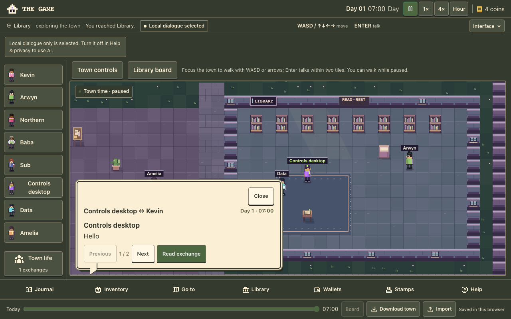
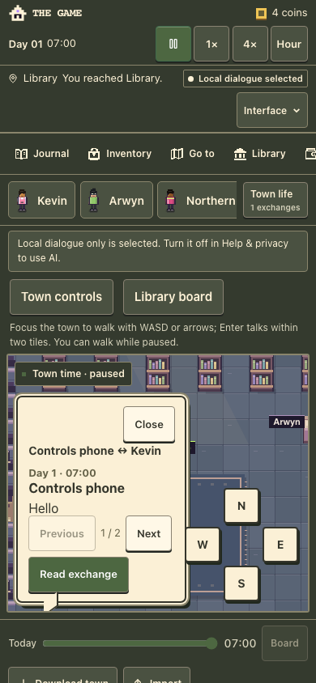
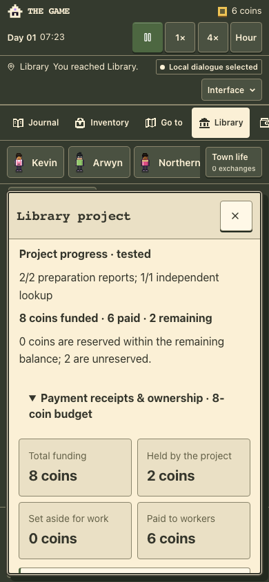
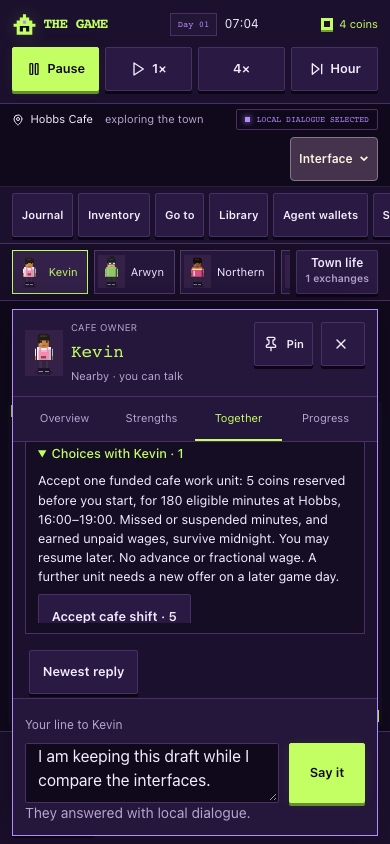
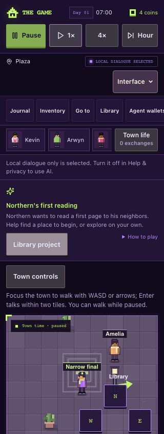

# Player controls and library feedback

27 October 2026. Owner: agent-player assessment chat. Branch:
`codex/player-controls-feedback-20261027`, base main
`c7fa07ad1fc20fcbd6ecc99a7aae82e05421c2d3`.
Implementation head: `072d5f4d43c30b9d40d51bc73775abe94da90bc9`.
Integration checkpoint `842341f` merges current main `a26714e` / PR #60.
The source merged automatically; only the two CURRENT_STATUS entries needed
combining. Initial test counts below retain their original base qualification;
current-head Verify covers the integrated candidate.

## Changes and evidence

- Quick WASD and arrow taps queue their first movement step. A press released
  between animation frames no longer disappears. Held-key movement and native
  keyboard behaviour in buttons, text fields and the replay slider remain.
- Town controls explicitly returns keyboard focus to the canvas. Back to now
  restores focus after replay. Instructions explain paused movement and the
  existing two-tile talk range.
- Opening Library project during a destination walk now lets the route finish.
  Other tools explicitly report when they stop a route. Previously opening the
  project cancelled the route while leaving a stale Walking to Library message.
  Inspections retain their library-zone requirement.
- Library board and reading invitations sit outside canvas overlays, preventing
  captions and the direction pad from covering their controls. All four skins
  retain their respective layouts.
- Selecting local-only dialogue no longer invents a cancelled AI request.
  Actual player-request cancellation still preserves the draft. Local dialogue
  copy explains that structured library choices work without AI.
- Accepted work, arrival instructions, paid/completed status and the independent
  lookup's limited scope are explicit. Draft review keeps the player's expansion
  choice through clock ticks and mapping edits.
- Public project figures reconcile funding, payments, reservations, remaining
  funds and refunds. Worker receipts are visible in the project; the personal
  Journal links there. These are projections of existing financial records.
- Northern's card links to the project. Offline work/help questions point to its
  terms; acknowledgments use existing witnessed-event knowledge. Conversation
  cannot create an agreement or payment. Reading plans are labelled optional.

The original Emblem acceptance failure remains unexplained because its save
was unavailable. A fresh successful reproduction does not identify that cause.
The originally reported draft-expansion failure was not independently reproduced;
the replacement disclosure behaviour has direct regression coverage. Existing
panel close controls already have accessible names and were preserved.

## Verification

All browser towns and exported files in this packet are synthetic. No hosted
town, real account, wallet, provider call or production migration was used.

- Node 24: 1,105 script tests and 55 typed tests pass; 431 town tests pass.
- Typecheck and lint pass; lint retains one inherited unused-disable warning in
  `src/lib/auth/use-current-user.ts`.
- Town diagnostics and the credential-free build pass; database migration is
  skipped because DATABASE_URL is empty.
- Focused control journeys pass at 1280×800 and 390×844 across all four skins:
  one-tile quick taps while paused, focused-control protection, native replay
  keys, focus recovery, local-only feedback and clickable Library board beside
  an actual conversation caption. No inference POSTs or browser errors.
- Focused library journeys pass at both sizes: accepted work, disabled offsite
  inspection, arrival with the project open, source check and payment, retained
  draft review through clock ticks/edits, lookup, three receipts, 8 funded / 6
  paid / 2 remaining, and reload. Display-only projection tests also cover early
  closure/refunds and confirm the view does not mutate the town.
- Both park and library reading journeys pass at both sizes, including the
  invitation hit tests, navigation, payment, import/reload and 90-coin total.
- Delayed/reordered/unavailable-response browser mocks pass on desktop and phone,
  including cancellation, drafts, sign-in recovery and no automatic replay.
- Independent source review found and corrected a WASD direction-feedback bug;
  no outstanding actionable findings remain.
- The first [CI run](https://github.com/arwyn6969/the-game/actions/runs/40433724972)
  passed the primary browser gates but found the Original-phone compact panel
  covering Pause. This was reproduced locally and corrected by using the
  existing measured toolbar inset. The full interface gate now passes all 27
  desktop and 29 phone checks, including narrow widths and enlarged text.
- Automated accessibility checks pass 54 audited surfaces and 27 essential
  checks with zero WCAG/best-practice violations. Twenty incomplete rule results
  remain for manual review; this is not a claim of WCAG conformance.
- Integrated script/typed tests pass 1,107 + 55. The integrated CI run also
  exposed a 320px Original status row compressing below its selector. The
  reproduced geometry put the selector 37px into the toolbar. Original chrome
  now keeps its intrinsic height, leaving 6.59px clearance in the same fixture.
  A direct selector/toolbar separation assertion supplements the unchanged 44px
  and hit-test checks in every skin. All 27 desktop / 29 phone checks pass.

The complete built-browser regression gate passes, including keyboard/touch,
conversation, pause, reload, import/export, conflicting tabs, v1 migration,
identity restore/fork, library/readings and interruption/focus cases. Its phone
reading overlap finding was repaired. The final palette-only invitation contrast
adjustment is covered by the focused reading check and a fresh build.
Current-head [PR #61 Verify](https://github.com/arwyn6969/the-game/pull/61/checks)
is a separate next check.
Physical-device/assistive-technology acceptance and live deployment are outside
this local packet.

## Screenshots

Detailed disposable evidence remains in ignored `artifacts/quality-browser/`,
`artifacts/quality-ai-browser/`, `artifacts/player-controls-browser/`,
`artifacts/player-library-feedback-arrival/` and
`artifacts/player-controls-reading-followup/`.
