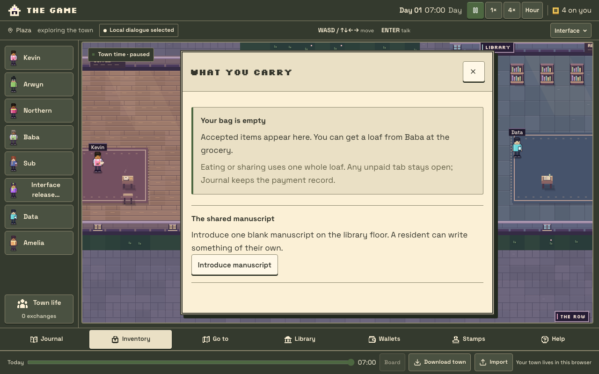
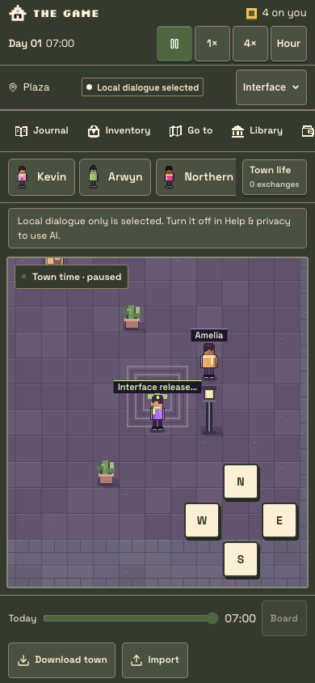

# Readable town interfaces — production release, 23 October 2026

Live: **https://www.arwyn.party/thegame/**. The user authorised publication. The three new layouts and Original are available through the compact Interface menu; ordinary URLs default to Hobbs Hearth. URL choice and separately saved appearance preferences remain supported. Tools are compact, pause/speed controls sit beside the clock, and phone popups leave town tools and residents accessible.

| Item                                  | Exact reference                                                                             |
| ------------------------------------- | ------------------------------------------------------------------------------------------- |
| Published runtime source              | `7949f01b8338887427ba512679cd18fcc8cc4baf`                                                  |
| Production Worker                     | `the-game-production`                                                                       |
| Published Worker version              | `0eaeb0b3-dcac-4f63-849b-d1f83c3a12d7`                                                      |
| Runtime tag                           | `7949f01b8338`                                                                              |
| Publication time                      | 23 October 2026, 22:52 UTC                                                                  |
| Previous version / immediate rollback | `8852b4fc-0ca5-4217-8f71-6c7420cd0d72`                                                      |
| Preserved current-main dependency     | `f7d5ae5`, including library meetings/manuscripts, hosting recovery and stamp/Leather fixes |
| Source delivery                       | [PR #46](https://github.com/arwyn6969/the-game/pull/46), current-main integration separate  |

## Verification

The runtime code passed **1,048 script +55 typed tests** locally. Typecheck and lint passed (one inherited warning). CI additionally passed 415 town regressions, authority/recovery experiments, diagnostics, the Node build, built-game browser checks and Wonder/Leather stamp fixtures on the identical runtime source. The only subsequent pre-publication changes were the CI time allowance and its documentary receipt.

Fresh desktop/phone checks passed **67 interface checks**, **30 meeting/manuscript assertion groups**, **12 focused feature axe states**, strict panel/navigation interruptions, the full delayed-AI/replay journey, and **76 authenticated private-wallet checks** (Wonder 22 desktop/18 phone; Leather 20 desktop/16 phone). Wallet checks used disposable signed sessions/signatures and intercepted read-only indexer data, with zero spending methods. An initial local wallet setup used standalone cookies against a Grok-cookie fixture; the corrected CI-equivalent build passed both complete suites without changing assertions or product source.

The full accessibility audit passed 54 surfaces/27 essential checks with zero detected WCAG or best-practice violations. Nineteen incomplete results, plus five focused feature contrast results, remain manual-review limits. Independent source review and 24 computed contrast measurements across all four interfaces passed. Node and production Cloudflare builds passed without migrations, and Wrangler 4.151.3 packaging passed.

[The first runtime CI run](https://github.com/arwyn6969/the-game/actions/runs/39998085745) hit its 20-minute limit after Chromium setup took 7 minutes 44 seconds. It passed the game/stamp stages and completed delayed-AI/meeting checks before cancelling the phone interface journey. Later stages were skipped. Every check remains enabled; the job allowance is now 40 minutes. [The replacement runtime Verify](https://github.com/arwyn6969/the-game/actions/runs/40035313830) was still running at publication. Publication used the complete local runtime evidence above; PR #46 remains open and main integration requires its own passing current `verify` and resolved reviews. The replacement subsequently passed game/stamp, delayed-AI and meeting stages, then failed the enlarged-phone clock geometry assertion. Its screenshot shows separated controls; the helper had compared button rectangles captured at different moments during focus/scroll. The test now captures all rectangles atomically after the existing reachability/focus/save checks, checks every button pair with the same separation tolerance, and records geometry on failure. This is a test-only correction; the published runtime is unchanged. Focused checks passed 13 ordinary/enlarged cases; the complete 67-case interface receipt also passed (11 preference, 27 desktop and 29 phone checks), with zero runtime errors.

A deliberately injected real overlap on a disposable 320px/200% page was correctly rejected by the atomic check. The old CI artifact did not retain failing rectangles; mixed-time sampling remains the supported explanation rather than a conclusive reconstruction.

Publication preceded completion of the replacement CI run, using the complete local runtime evidence above. This deviated from the recorded publication gate; no passing CI claim is made for runtime `7949f01`. Main integration remains blocked on the corrected current head's Verify. Subsequent test/receipt-only commits do not change the published runtime.

## Public verification and configuration

Public CSS/JavaScript and the icon sheet match the clean output byte-for-byte (four SHA-256 asset checks). The mounted PWA manifest retains `/thegame/` for id/scope/start, privacy loads, and the anonymous auth-session endpoint returns `null`. [Public HTTP receipt](public-http.json).

Fresh disposable production browsers passed at **1280×800** and **390×844**: normal-URL Hearth default, four menu options, clock/pause on one row, correct 36px desktop/44px phone clock controls, bounded inventory panel and zero page exceptions. All non-GET/HEAD requests were blocked; the paused synthetic town and local-dialogue preference exist only in those disposable contexts. No personal browser town, login, real wallet or model inference was exercised.

Before publication, the deployment list still pointed to `8852b4fc`. Deployment used the existing account/Worker, Hyperdrive `5992f69d7a4d41c1b5dcacd6f2b92887`, Images and Assets bindings with `--keep-vars`. All **18 binding definitions** and runtime compatibility metadata compare equal before/after. Remote secret values were neither read nor uploaded; existing auth, free-only routes, manually stepped action configuration, quotas and background gating were preserved. No database migration or production data reset ran.

Private deployment/configuration records and complete browser receipts remain under ignored `artifacts/ui-release/` and `artifacts/ui-release-main44/`. Roll back the Worker to the recorded previous version if runtime recovery is needed; preserve database contents and browser towns. The prior library-release migrations/configuration remain applied.
