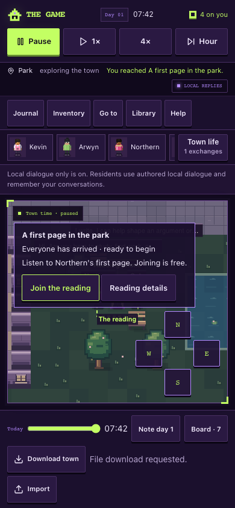
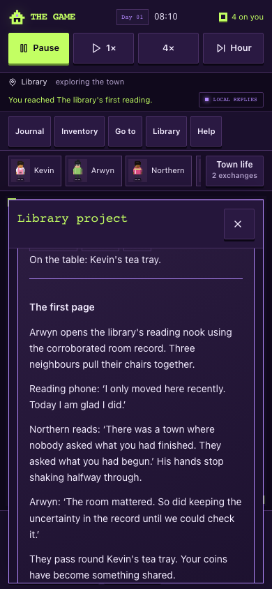

# Northern's first reading — 15 October 2026

The user requested improvements to the quest, money and payoff before publication. This pass gives the existing library project a human purpose and a visible gathering, on the same draft quality branch. Runtime source is `7b5233ac778605ef744716be6d7d4efa3f201bfb`; later receipt commits do not change game behavior. It preserves the earlier funded work, cast, art, personal towns and deployment boundary.

## What changed

| Previous weakness                                                      | Resulting behavior                                                                                                                                  |
| ---------------------------------------------------------------------- | --------------------------------------------------------------------------------------------------------------------------------------------------- |
| Filing records had little emotional purpose                            | Northern wants to read one page to his neighbours. The opening invitation and library panel explain whom the work helps.                            |
| Reports gave answers that still had to be copied into dropdowns        | Directly inspected box locations carry into an empty draft. An optional review lets the player change them; unsupported choices remain provisional. |
| The outcome mostly lived in administrative text                        | Named guests walk to distinct seats, a book marker identifies the gathering, and a short authored scene records the result.                         |
| The quest offered little choice beyond correct or incorrect references | Choose a small park reading with Northern and Sub, or wait for corroborated room evidence for a library reading with Northern, Arwyn and Sub.       |
| Waiting for a later-day note created empty time                        | New or explicitly adopted invitations use a note due 30 game minutes after the actual lookup receipt, with a disclosed ordinary-simulation wait.    |
| Earned money had little immediate purpose                              | Optional bread and tea trays cost two coins each, paid into the actual grocery or cafe till. Attending and speaking remain free.                    |
| A player contribution ended with payment feedback                      | Join to listen or explicitly volunteer a quoted first line. The scene, actual attendance and optional purchases persist after reload.               |

This adds one bounded authored encounter. It does not establish a general job market, an endlessly sustainable economy or measured player enjoyment. The two venues have different guests and scene lines; they are not two separate ongoing quest chains.

## Rules and compatibility

- A scene requires actual guest arrival, with prior paid work respected. Newly received timetables survive the invitation and its cleanup. A work replan can demote readiness immediately without advancing time or money.
- After 60 ready game minutes with the player elsewhere, guests may go ahead. Sub's public note states the player's absence; it does not invent attendance or impose a financial or trust penalty. A player standing beside the guests retains their participation choice.
- Each optional tray has one exact cash receipt. A repeated action, stale quote or reload cannot buy it twice or settle an unrelated personal bread tab. Scene refreshments derive from real payments during the booked gathering.
- The original paid preparation and independent lookup remain separately attributed and funded. A wrong reference can fail honestly and still earn its agreed fee. Closing the funding does not cancel a supported free reading.
- The version-2 town and version-1 import contracts remain. The reading is an optional project extension; older projects without it load without invented attendance and can explicitly adopt the story. Malformed extensions preserve the raw save for recovery.
- Version-1 scene text is part of the saved reading contract. Future story rewrites need an explicit extension migration; changing the canonical text alone would reject previously completed readings.

## Verification

Node 24.19.0: the full suite passes **573 tests** (518 script and 55 app/auth), including **281 town cases**. Typecheck passes. Lint reports zero errors and the one inherited unused auth directive warning. Town diagnostics complete. Focused coverage includes twelve reading lifecycle cases, nine cash-sale cases and three import/replan integrity cases. The final production build passes with database/provider credentials removed and migration explicitly skipped.

Disposable ordinary-control built browser journeys pass both park/listen/bread and library/read/tea at 1280×800 and 390×844. Each preserves the 90-coin fresh-town total and exports/imports/reloads its actual scene. There are zero page/console errors or provider requests in those journeys. The same integrated gate also passes normal keyboard/touch movement, pause/time, offline conversation, old library success/failure, version-1 migration, reload, portable saves and competing-tab recovery.

The browser pass reproduced and fixed an indoor route that stopped the player on Sub's seat. Reading navigation now reaches its exact dedicated player tile; ordinary destination navigation retains its existing arrival radius. Phone inspection also removed overlapping floating conversation controls while the player is at the pending gathering and shortened its free invitation. A permanent browser regression checks four inset corners of both inline buttons are uncovered, then joins the reading through that control. Conversation history, resident cards and touch movement remain available.

The mocked delayed-AI/recovery gate passes desktop and phone with 21 mocked requests, zero network leaks, zero real provider calls and zero page/console errors. It was rerun before the final invitation-copy-only refinement; the source is recorded in the verification data. The new reading browser harness is part of the existing CI browser gate. No real provider call, production database migration or hosted publication was performed.

[Verification data](../review/first-reading-2026-10-15/verification.json) · [Final built journeys](../review/first-reading-2026-10-15/built-browser.json) · [Reading and inline controls](../review/first-reading-2026-10-15/inline-join-browser.json) · [Mocked AI and recovery](../review/first-reading-2026-10-15/delayed-ai-browser.json)

## Remaining evidence

Run the [five-person playtest](../implementation/game-quality-playtest.md) to assess whether players care about Northern, understand the venue choice, and find spending worthwhile. Automated arrival/payment checks cannot answer those questions. Physical-device accessibility, live operator configuration and separately authorized publication remain open. Cross-device saves and a continuously running shared town remain deferred.
