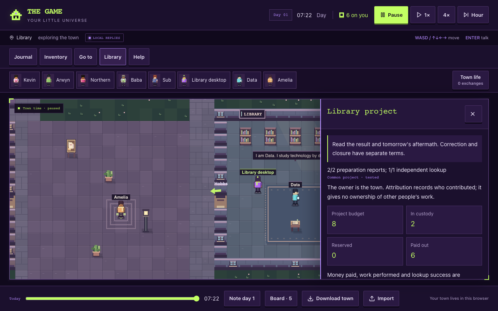
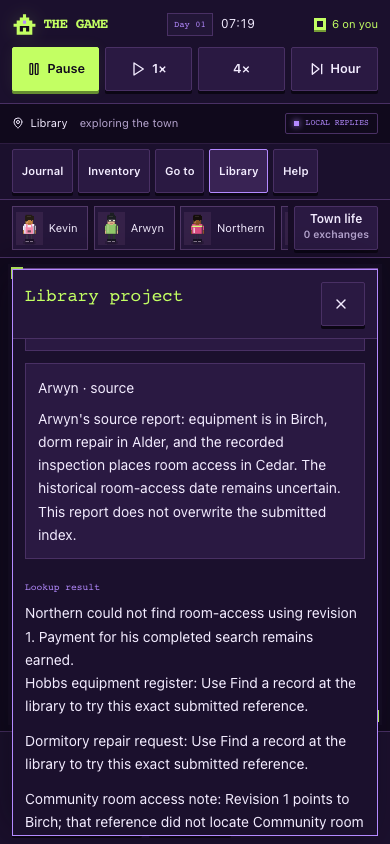

# Current backlog implementation receipt — 15 October 2026

The current-game backlog from the [quality review](2026-10-13-game-quality.md) is implemented on `codex/game-quality-review`. The user confirmed that cross-device saves and a continuously running shared town stay deferred. Runtime fixes are recorded at `128e1d425a75776d1ef75cf5e0075f6c6891d9c8`, integrating main through `4a39cdf8ec8c03b79d0e369e99dd7c862c9d8375`. Later handoff commits add test automation and evidence rather than change the game rules. This receipt describes a local candidate, not a hosted release or measured enjoyment score.

## What changed

- The library is a playable offline activity: eight existing coins fund preparation, independent routed search and a bounded correction. Evidence, player or delegated authorship, failed or successful lookup, free public use, optional Sub notice, next-day consequences and closure have persistent records. Failed useful-output tests do not confiscate agreed pay.
- The eight-actor ledger protects payroll before grants, conserves valid imported balances and debts, removes unexplained nightly funding/caps, and retains employer-specific work, reservations and earned liabilities through interruption and midnight. Legacy evidence needs honest classification and explicit funded recognition where ambiguous.
- Permanent Help, Journal, Inventory and destination navigation support keyboard, touch and single-step movement. A loaf can be eaten or voluntarily shared once; the old debt remains. Current main's art, cards, town-life feed, pin behavior, resident drafts and remembered deeds are preserved.
- Multi-tab saves compare their source snapshot and use browser locks. Conflicts preserve both copies; imports back up before replacement. Invalid current financial/project state keeps raw recovery data. Direct and background AI obey local-only mode, reject stale results and leave controls responsive; replay cancels pending speech and keeps its draft.
- Partner-first relationship context, complete-record bounded archives and everyday local answers improve dialogue without granting private project knowledge. Both server provider modes use verified identity and conservative global/per-user shared-budget reservations; missing accounting falls back locally.

The [delivery guide](../implementation/game-quality-delivery.md) explains how to play and operate the candidate. [The roadmap](../ROADMAP.md) now separates implemented scope from remaining evaluation and release gates.

## Fresh validation

Node 24.19.0 was used. All browser towns were isolated synthetic contexts. No paid provider call, personal save, live database migration, production secret change, merge to main or hosted publication was performed.

| Check                             | Result                                                                                                                                                                                                                                                                                                                                                                              |
| --------------------------------- | ----------------------------------------------------------------------------------------------------------------------------------------------------------------------------------------------------------------------------------------------------------------------------------------------------------------------------------------------------------------------------------- |
| Typecheck                         | Passed after the final runtime fixes                                                                                                                                                                                                                                                                                                                                                |
| ESLint                            | Zero errors; one inherited unused-disable warning in `src/lib/auth/use-current-user.ts:59`                                                                                                                                                                                                                                                                                          |
| Full `npm test`                   | 539 passed: 484 script tests and 55 app/auth tests; zero failures or skips                                                                                                                                                                                                                                                                                                          |
| Town regression command           | 240 passed on the integrated tree; subsequent community coverage is 19/19, including seven added final cases, and all are included in the final full suite                                                                                                                                                                                                                          |
| `diagnose:town`                   | Completed; diagnostic observations are not a release verdict                                                                                                                                                                                                                                                                                                                        |
| Credential-free production build  | Passed; database migration explicitly skipped. Vercel config version 3, server function and all three PGlite binary assets present                                                                                                                                                                                                                                                  |
| Built browser journeys            | 1280×800 keyboard and 390×844 actual touch input: name, movement, pause/time, permanent tools, local conversation, import/export, reload, v1 migration and byte-preserving competing-tab recovery passed                                                                                                                                                                            |
| Ordinary-control library journeys | Desktop correct Cedar reference succeeded; phone deliberately wrong Birch reference failed. Both paid six coins, retained two in custody, conserved the total 90, and preserved the result through portable import and reload                                                                                                                                                       |
| Delayed-AI browser journeys       | Desktop held a background request 30 seconds while movement/time/Journal worked. Both views rejected imported, reordered and replay-cancelled output, retained walk-away drafts, and applied manual fallback once. Desktop also tested the 15-second automatic timeout once. Local-only emitted zero player/background requests. Zero console/page errors or real provider requests |
| Long synthetic play               | 90/180/365 days, 56 exchanges/day; 20,440 exchanges at the final checkpoint. All world/account audits clean, all exports reimported, money stayed 90. Export sizes 1,101,220 / 1,169,696 / 1,271,733 bytes; reimport 24 / 21 / 25 ms on this machine                                                                                                                                |
| Diff and CI shell syntax          | Passed. CI runs both built journeys and the mocked delayed-AI/replay gate, and uploads their artifacts                                                                                                                                                                                                                                                                              |

Machine-readable evidence: [verification](../review/quality-2026-10-15/verification.json), [built browser](../review/quality-2026-10-15/browser.json), [mocked AI](../review/quality-2026-10-15/delayed-ai-browser.json), [longevity](../review/quality-2026-10-15/longevity.json). The repository intentionally excludes portable synthetic town files as well as real player saves.

Two independent final reviews checked effects/UI/save authority and community validation. Their concrete findings were fixed: replay fallback could bypass the normal freshness guard, Sub's notice used the player's author, and imported free-search prose could contradict its saved revision. Regression coverage now includes those cases, both notice-confidence policies, remote/stale rejection, repeated free use and preserving an old failed search after correction.

Some initial browser attempts failed in test infrastructure: stale Vite optimization after the main merge, duplicate mock-module initialization, external-font waiting, and a phone test trying to download through an open panel. The repeatable harnesses were corrected and rerun to the passing results above. Assertions were retained; no runtime auth, production transport or money safeguards were relaxed.

## Remaining gates

The [five-person uncoached playtest](../implementation/game-quality-playtest.md) has a protocol and blank observation form, not invented findings. It must establish comprehension and interest in a further visit. Physical-phone keyboard behavior, screen-reader use, live provider quality/capacity, deployment tariffs/shared migration and separately authorized hosted publication still need direct evidence. Protected story history can grow; the synthetic year is not an infinite-memory or device-performance guarantee. A closed eight-coin demonstration does not prove a sustainable general economy.

Account synchronization, a background shared town, more residents/map, banking, broad jobs and provider migration remain outside this delivery. Preserve portable backups when switching versions: an older runtime cannot safely maintain the new financial extension.
