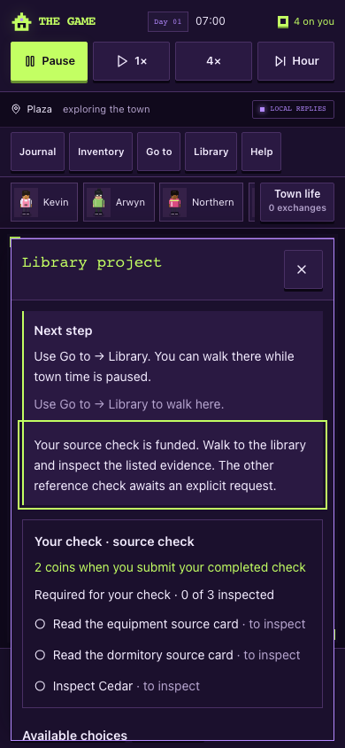
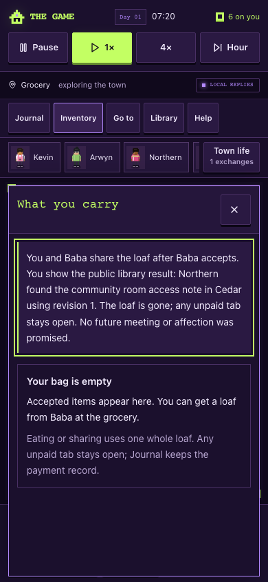

# Second pass on the new features — 15 October 2026

The user requested another improvement pass before going live, focused on the work just added. This refines the [first delivery](2026-10-15-game-quality-delivery.md) on the same review branch. Runtime source is `5c33966f8c4ae6f0c0e2cfa71ffa0f6c1feecae0`; following evidence/handoff commits do not change game behavior. Hosted publication remains separate.

## What is better

| Before                                                                                                        | After                                                                                                                                                       |
| ------------------------------------------------------------------------------------------------------------- | ----------------------------------------------------------------------------------------------------------------------------------------------------------- |
| The library gave broad instructions and a long list of records                                                | The next step follows actual progress; a checklist shows exactly which required inspections remain, with other evidence clearly separated                   |
| The player had to infer whether a report earned money                                                         | Their own check shows the two-coin fee as promised, earned/pending, or paid; paid work and a useful result stay separate                                    |
| Accounting words and small headings made the phone panel harder to read                                       | Plain money labels explain what is held, set aside and paid; readable headings, wrapping and large controls preserve access                                 |
| Actions could disappear with keyboard focus dropping out of the panel                                         | Terms and disabled reasons are associated with their buttons; completed one-use actions move lost focus to their outcome                                    |
| Arwyn's report could refer to an inspection not yet performed                                                 | Her source report requires the actual recorded Cedar inspection; requesting it early changes nothing and spends nothing                                     |
| An appointment could overwrite Northern's later plans or ignore a paid shift outside a hard-coded time window | The lookup respects his actual funded work schedule, pauses while he works, resumes afterwards and restores only its own temporary route                    |
| A completed shift could keep an open commitment item; late old wages could be confused with a new work unit   | New units have stable work-item identity; completion closes only the matching item and an old settlement cannot close a newer shift                         |
| Old local answers still described resetting/daily wages, or the wrong employer                                | Replies follow current funded terms, preserved legacy evidence, actual employer, recorded minutes and available choices                                     |
| Resuming an old shift could restore the whole old timetable                                                   | It restores the relevant employer attendance hours while preserving unrelated plans and original evidence                                                   |
| Closing a resident card during a delayed reply left the already-sent line in its draft                        | An accepted line clears that resident's matching draft even with the card closed; a newer unsent edit is retained                                           |
| Empty save bytes led to name entry, and a damaged save arriving during naming lacked a recovery route         | Both open explicit recovery without overwriting the stored bytes; paused movement saving and pending-import cancellation are also covered in browser checks |

The shared meal now uses an explicit completion flag rather than searching display text. Inventory describes eating, sharing and the surviving bread tab in one place. The lookup uses the record's readable name, and later-day guidance explains when Baba's evidence arrives and that game time stops while the app is closed. Closure terms show the amount each donor would receive after earned fees settle.

## Verification

Node 24.19.0: **549 full tests passed** (494 script + 55 app/auth), **257 town tests passed**, typecheck passed, lint had zero errors and the one inherited auth warning, and town diagnostics completed. Focused coverage includes 24 community cases, 41 work/memory/social cases and 10 save cases. The production build passed with database/provider credentials unset and the migration explicitly skipped.

Fresh disposable desktop and phone checks verified library success/failure, portable export/import/reload, required-inspection progression, earned/paid feedback, sharing, keyboard focus and no horizontal overflow. The expanded mocked-AI/recovery journey passed both sizes with 21 mocked requests, zero real provider/server-function requests and zero page/console errors. It includes empty/naming recovery, paused movement autosave/reload, import during a foreground wait, closed-card replies, newer unsent edits, fallback, reordering, replay and local-only behavior.

[Verification data](../review/quality-polish-2026-10-15/verification.json) · [Built desktop/phone journeys](../review/quality-polish-2026-10-15/built-browser.json) · [Mocked AI and recovery](../review/quality-polish-2026-10-15/delayed-ai-browser.json)

## Remaining evidence

These are implementation and automated observations, not human enjoyment ratings. The [five-person playtest](../implementation/game-quality-playtest.md), physical-phone keyboard and screen-reader checks, live provider/configuration checks and authorized hosted publication still require direct evidence. Earlier unreleased work items without a trustworthy agreement link are preserved instead of being guessed away. Cross-device saves and a continuously running shared town remain deferred.
