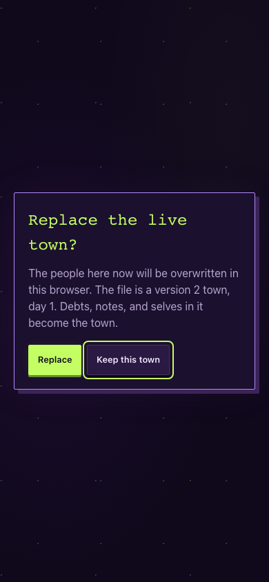
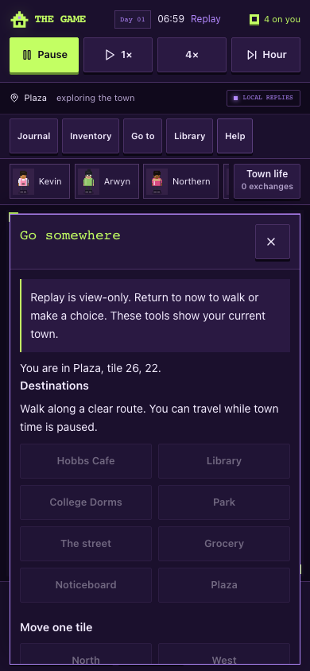

# Further bug pass — 16 October 2026

The user requested another search for bugs and practical improvements. This pass starts from `d67b316` and fixes reproduced failures in the existing game. Runtime source is `8bb77c4c0430c06bebb7fc0a2ea4c49c08ef15d0`; following evidence commits change documentation only. The same draft PR remains the review handoff.

## Reproduced problems and changes

| Trigger and previous behavior                                                                                                        | Result                                                                                                                                                                           |
| ------------------------------------------------------------------------------------------------------------------------------------ | -------------------------------------------------------------------------------------------------------------------------------------------------------------------------------- |
| Choose a one-tile move during replay, then return to now: the live player silently moves                                             | Replay movement controls are disabled and guarded; entering and leaving replay clears held and queued inputs. Tools clearly identify current-town information.                   |
| Close Journal with Escape: keyboard focus drops to the page body                                                                     | Escape restores the tool opener, matching its close button. Resident/board dismissal returns to the canvas.                                                                      |
| Import a file while travelling: confirmation has no dialog semantics, keyboard focus stays behind it, and Escape does not dismiss it | Confirmation stops the destination walk, pauses movement and simulation during review, focuses Keep this town, contains Tab focus, supports Escape and restores focus afterward. |
| A legacy wage starts underfunded, then its shop receives real cash: the wage stays stranded                                          | Payroll retries protection when a complete wage becomes fundable; completed old wages settle once. An unworked player's old evidence still requires explicit recognition.        |
| There is only enough new cash for one old claim: an unworked unit can reserve it ahead of completed unpaid work                      | Newly fundable completed wages take priority. Existing holds and claim evidence remain untouched.                                                                                |
| An imported attendance array is invented, erased, moved to another minute or future-dated while its length still matches the counter | Every attendance minute must match its trusted worker/agreement command. Unsupported records open recovery instead of generating credit.                                         |
| Stand on a guest's exact reading seat: the guest reaches the adjacent tile but the gathering never becomes ready                     | An actually adjacent guest in the same venue can gather beside an occupied seat. Work still takes priority; distant guests cannot count as present.                              |
| Publish verified, then marked, then choose verified again: the action succeeds but the event is deduplicated, posting nothing        | Each already recorded revision/policy action stays completed, even after switching policy.                                                                                       |
| An unfinished reading's receipt projection is corrupted: a paid tray appears unpaid and can be offered again                         | Existing sales and supplied-tray events must have their exact cash receipts. Corruption preserves the raw save for recovery.                                                     |
| Ask a participant “How was the reading?”: the local reply does not recognize the quest                                               | Natural reading questions retrieve that resident's actual reading events. Uninformed residents cannot borrow an unrelated preparation payment as knowledge of the scene.         |
| A wage is recorded in the accounts but has no old prose receipt: the online reply guard denies the payment                           | Local dialogue, prompt facts and online grounding share employer-bound payment evidence and retain the original payment date. Asking cannot move money.                          |
| A wage memory has an impossible date, future date or wrong amount: it can appear among authoritative prompt facts                    | Those records remain stored but are excluded from wage facts. Statements also remain distinct from events.                                                                       |
| Economy/save modules load before effects: the exported shift text can snapshot an uninitialized circular import and acceptance fails | The exported name is a live binding. Separate module-order regressions accept exactly one funded shift without charging or paying the player.                                    |

## Verification

Node 24.19.0: **596 full tests pass** (541 script and 55 app/auth), including **304 town cases**. The pass adds 23 engine regressions: twelve dialogue/module-order/date cases, six payroll/import cases and five reading/notice/receipt cases. Typecheck passes; full lint reports zero errors and the one inherited unused auth directive warning. Town diagnostics complete and the production build passes with database/provider credentials removed; migration is explicitly skipped.

The new ordinary-control UI gate passes both development and production-build desktop 1280×800 and phone 390×844 checks for Escape focus, replay movement, destination cancellation, import confirmation and older closed-project feedback. It reports no page/console errors, provider requests or horizontal overflow. The same gate is now integrated into the built browser check and CI.

The final integrated built journeys also pass movement, pause/time, local conversation, library success/failure, both reading choices, optional purchases, version-1 import, portable export/import/reload and competing-tab recovery. The mocked-response gate passes desktop and phone with 21 mocked requests, zero real provider calls and zero page/console errors. The built Help identifier is `8bb77c4c0430`. No production settings, schema versions, canonical saved scene text, provider accounts or hosting were changed. No paid calls, merge or publication were performed.

[Verification data](../review/bug-pass-2026-10-16/verification.json) · [Built journeys](../review/bug-pass-2026-10-16/built-browser.json) · [UI edge cases](../review/bug-pass-2026-10-16/ui-edge-browser.json) · [Mocked AI and recovery](../review/bug-pass-2026-10-16/delayed-ai-browser.json)

## Remaining evidence

This is regression evidence, not proof of human enjoyment. The [five-person playtest](../implementation/game-quality-playtest.md), physical-phone keyboard/screen-reader checks and live operator configuration still need direct evidence. Cross-device saves and a continuously running shared town remain deferred. The [first-reading receipt](2026-10-15-first-reading.md) preserves the preceding story pass.
