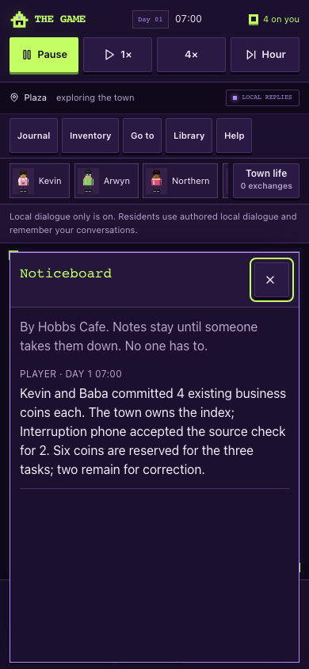

# Interrupted play and save recovery — 16 October 2026

The user requested a fresh search for bugs after the earlier pass. This pass starts from `479986806a6a8a15c9bac105e208e0277e9d39b6`; runtime source is `fb9abc1dd9b8487794a2808578fd92410090d629`. It concentrates on changing screens, interrupted work, dated conversations and existing saved towns. The same draft PR remains the review handoff.

## Reproduced problems and fixes

| Trigger and previous behavior                                                                                                                    | Result                                                                                                                                                                                                               |
| ------------------------------------------------------------------------------------------------------------------------------------------------ | -------------------------------------------------------------------------------------------------------------------------------------------------------------------------------------------------------------------- |
| Open Inventory, then select Kevin: the selected resident changes but his card stays hidden                                                       | Selecting a resident replaces the open tool and displays the requested card.                                                                                                                                         |
| Open Library, then Board, then Help: panels overlap and cover the new close button; closing Board loses focus                                    | Tools, resident cards and Board replace each other. Board stays below navigation, focuses its close button and returns focus to its opener on Close or Escape.                                                       |
| Use arrows on the character tab list: nothing happens and all tabs consume Tab stops                                                             | Arrow keys, Home and End select and focus tabs; one tab is in the Tab order. Selecting Together by keyboard keeps focus on its tab.                                                                                  |
| Ask about yesterday's wage before midnight, reload after midnight, then ask “How much?”; or ask “What about today?” followed by “How much?”      | Local replies retain the original absolute day and respect the newest explicitly requested date. Receipt dates and payment amounts stay unchanged.                                                                   |
| A model response repeats the same relationship, plan or reflection row                                                                           | Each directed relationship changes at most once; each resident receives one plan and at most two reflections per response. Duplicate rows cannot repeat project or memory side effects.                              |
| Import a completed, settled wage whose matching task projection was not closed before the interruption                                           | The exact completed work item closes without another payment or closing newer work. Open project IDs are indexed first to avoid quadratic searches through historical wages each minute.                             |
| Change a payment, reservation or release to another otherwise valid past minute in a save                                                        | Its date must match the authorizing command receipt. Contradictory files retain their raw bytes for recovery.                                                                                                        |
| Correct a recorded debt payment through the trusted engine, reload, then repay the restored tab: its old receipt replays and leaves the tab owed | Repayment after a correction gets a stable new command identity. Tuple encoding avoids collisions with valid old debt IDs containing correction suffixes. Ordinary retries and stale player quotes cannot pay twice. |
| Finish Northern's lookup: the board says Baba's note arrives on day 3 despite the new invitation making it due 30 game minutes later             | Guidance shows the actual earlier game day and time, including midnight and overdue notes. Older projects retain their original deadline until explicitly adopting the invitation.                                   |

## Verification

Node 24.19.0: **610 full tests pass** (555 script + 55 app/auth), including **318 town cases**. Fourteen new engine regressions cover five response/date cases, five work/accounting/import cases and four quest interruption cases. Typecheck and town diagnostics pass. Lint has zero errors and the one inherited unused auth directive warning. The production build passes with database and provider credentials removed; database migration is explicitly skipped.

Built desktop 1280×800 and phone 390×844 journeys pass movement, pause/time, local conversations, both reading venues, library success/failure, optional cash purchases, portable import/export/reload, v1 migration and competing-tab recovery. The permanent UI interruption gate adds ordinary menu switching, focus restoration, tab keys and a real touch cancellation sequence; money stays unchanged by these controls. It reports no page/console errors, provider requests or horizontal overflow. It now runs inside the integrated browser gate and CI.

The delayed-response/recovery gate also passes on desktop and phone: 21 mocked requests, zero real provider calls and zero page/console errors. The local built preview at `http://127.0.0.1:8094/` serves runtime `fb9abc1dd9b8`; browser saves remain on the same origin. Tests used isolated synthetic towns.

The first CI attempt caught a timing race in the phone test: its Enter shortcut ran while Help was restoring focus, so Enter correctly reopened Help. A deterministic delayed-frame reproduction confirmed the cause. The harness now lets queued focus restoration finish and explicitly focuses the town before using Enter. The repeated complete mocked gate passes with all existing assertions retained; product controls and the tested runtime are unchanged by this harness repair.

[Verification data](../review/interruptions-2026-10-16/verification.json) · [Built journeys](../review/interruptions-2026-10-16/built-browser.json) · [UI interruptions](../review/interruptions-2026-10-16/ui-interruptions.json) · [Mocked AI and recovery](../review/interruptions-2026-10-16/delayed-ai-browser.json)

## Remaining evidence

Town schemas, saved version-1 reading scene text, auth, hosting and production settings are unchanged. No paid calls, production migration, merge or publication were performed. Human playtesting, physical-phone/screen-reader checks and live operator/provider checks remain separate release evidence; automated regressions do not establish enjoyment. Cross-device saves and a continuously running shared town remain deferred. The [earlier bug pass](2026-10-16-bug-pass.md) retains its own evidence.
